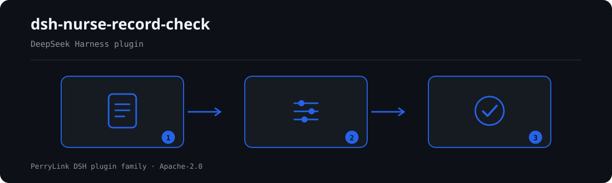

# dsh-nurse-record-check — 护理记录时限、签名与评估表完整性校验

[English](README.md) · [简体中文](README-zh.md) · [Español](README-es.md) · [Português](README-pt.md) · [हिन्दी](README-hi.md)

[](https://dsh.market/)
[](https://dshfind.com/en/plugins/PerryLink/dsh-nurse-record-check?ref=badge)

`dsh-nurse-record-check` 读取一次住院过程的机器可读导出材料——护理记录、医嘱与已完成的评估表——核对这份护理记录的时限、签名与评估表留存，逐条报出与所引条款的字面差异：每条护理记录是否留下可追溯的记录人与时间、日期与时间是否按 24 小时制书写且可解析、抢救记录的时间是否精确到分钟且是否在抢救结束后 6 小时内补记、临时医嘱是否记录执行时间与执行护士签名、取消的医嘱是否记录取消信息、首次护理评估与护理记录书写频次是否满足本机构配置的阈值、跌倒与压力性损伤风险评估表是否留存、巡视间隔是否与该记录所载护理级别对应的分级护理指导原则相符。无法执行的检查计入 `skipped`，不会静默通过。

## Install

```sh
dsh plugin --profile <name> add dsh-nurse-record-check
dsh --profile <name> --dump-config | grep 'dsh-nurse-record-check'
```

## 实际输出长什么样



*工作流概览：文档 → 规则包 → 核对结果。下面的示例使用实际命令面。*


本插件对自己 `NR-007` 测试夹具的**真实输出**，不是示意图。规则库不伪造引文，因此每条发现都会同时写明所引条款，以及该条款原文本次未取得。

## 它回答什么问题

### 示例

下表是示例集：第一行是详细走查，其余行是简短案例。


#### 详细输出

**工具** `nurse_record_check`

**输入**

~~~yaml
records:
  - id: REC-0001
    kind: general
    recordedAt: "2026-03-15 09:00"
    nurseId: N10231
  - id: REC-0002
    kind: general
    recordedAt: "2026-03-15 11:00"
    nurseName: 李护士
~~~
 
**输出**

~~~json
{
  "id": "dsh-nurse-record-check.NR-001.185cc700",
  "ruleId": "NR-001",
  "severity": "error",
  "locator": {
    "cell": "REC-0002"
  },
  "found": "记录无签名护士标识",
  "expected": "每条护理记录均应有签名"
}
~~~

*来源 `dsh-nurse-record-check/tests/fixtures/NR-001/NR-001-unsafe.yaml`*

| 你会问 | 它怎么答 |
|---|---|
| 有一条护理记录导出时没有签名护士，会被报出吗？ | 会。`NR-001` 会报出没有留下记录人标识的护理记录，也会报出不符合所配置工号格式的 `nurseId`。它只核对材料是否留下记录人标识与时间，不校验电子签名的技术实现。 |
| 导出文件里有一个时间值解析不了，这条规则怎么处理？ | `NR-002` 会报出该值，并要求时间按 24 小时制书写、可解析为 `YYYY-MM-DD HH:mm`。解析不了时间的记录随后不参与各条时限比对，所以它只在这里出现，不会变成一条时限差异——本条核对的是时间能否读出，不是时间是否真实。 |
| 抢救记录只写了抢救日期，没有具体时刻。 | `NR-003` 会报出只精确到日的 `rescue` 记录，因为抢救时间应当具体到分钟。规则库说明：它引用的两份文件要求的对象并不相同——一份要求「抢救时间」具体到分钟，另一份要求的是「记录时间」——故合并呈现并分别标注出处。 |
| 抢救记录第二天早上才补记，算超时吗？ | `NR-004` 拿记录时间与 `rescueEndedAt` 相比，间隔超过 6 小时即报出；书写时间早于抢救结束时间也会报出。没有 `rescueEndedAt` 时无从比对，本条会报告无法执行，而不是通过。 |
| 一条临时医嘱执行了，但执行护士签名栏是空的。 | `NR-005` 会报出执行记录缺执行时间或执行护士签名的临时医嘱。它只针对临时医嘱——长期医嘱单的内容项不同，不得互相套用——也不检查执行后多久签名，因为国家规范没有规定签名时限。 |
| 有些规则的结果是 `skipped` 而不是通过，说明什么？ | 说明该检查没有执行，不等于通过。`NR-008` 与 `NR-012` 的阈值（`maxAfterAdmission`、`intervalHours`）出厂为空，因为规则库没有找到可适用于护理记录的国家层面阈值——它同时写明：找到的 24 小时针对的是医师书写的入院记录，不得套用到首次护理评估上——`NR-011` 在特级护理下同样报告 `skipped`，因为指导原则未给出具体间隔，可比的 `rounds` 记录少于两条时也不执行。 |

## 依据的标准

| 文件 | 文号 | 引用它的规则 |
|---|---|---|
| 《电子病历应用管理规范（试行）》 | 国卫办医发〔2017〕8号 | NR-001, NR-006, NR-010 |
| 《病历书写基本规范》 | 卫医政发〔2010〕11号 | NR-002, NR-003, NR-004, NR-005, NR-007, NR-010, NR-012 |
| 《医疗质量安全核心制度要点》 | 国卫医发〔2018〕8号 | NR-003, NR-004 |
| 《卫生部办公厅关于在医疗机构推行表格式护理文书的通知》 | 卫办医政发〔2010〕125号 | NR-005 |
| 《护理分级标准》 | WS/T 431—2023（全部代替 WS/T 431—2013；推荐性卫生行业标准，2024-02-01 施行） | NR-008 |
| 《进一步改善护理服务行动计划（2023—2025年）》 | 国卫医政发〔2023〕16号 | NR-009 |
| 《三级医院评审标准（2020年版）》 | 国卫医发〔2020〕26号 | NR-009 |
| 《综合医院分级护理指导原则（试行）》 | 卫医政发〔2009〕49号 | NR-011 |

**边界（中文译文，以英文原文为准）：** 本插件核对一次**住院**诊疗中**护理**文书（护理记录）的及时性、签名与评估表记录。它不是 `dsh-medrec-qc`（后者核对病案首页及其内部矛盾），不是护理质量评分卡，也不是临床决策辅助工具。它读取机器可读的导出数据，并报出与所引条款之间的字面不符；它从不判定某次诊疗过程是否恰当。

## Compatibility

| 项目 | 状态 |
|---|---|
| Harness | 对等版本范围 `>=0.1.2-rc.1 <0.2.0 \|\| >=0.2.0-0 <0.3.0` —— 已实测同时接受 `0.2.0-rc.2` 与 `0.2.1-rc.2`。**已声明 `engines.dsh`**：0.2.1 起由宿主单独裁决，范围为 `>=0.2.1-0 <0.3.0` |
| Node | `^22.19.0 || >=24.0.0` |
| 平台 | 全平台（纯 ESM；无原生代码、无联网、不调用模型） |
| 工具模式 | `native` / `ptc` 均可；批量校验整个目录时建议 `ptc`，schema 成本只付一次 |

## What it does

规则表、字段说明与行为细节见 [README.md](README.md#what-it-does)（英文主版本）。本插件只列出材料与所引条款之间的字面差异，并对无法执行的检查在 `skipped` 中逐项说明。

## Configuration

全部可调参数都在 `src/config.ts` 的 Schemastery schema 中，只改 `cordis.yml` 即可生效，无需改代码；逐条阈值在 `rules/` 下的规则库文件里。

| 键 | 类型 | 默认值 | 说明 |
|---|---|---|---|
| `rulesFile` | string | `rules/nurse-record.yaml` | 规则库文件路径，相对插件包根目录 |
| `disabledRules` | string[] | `[]` | 要停用的规则 id 列表；每条都会出现在 `skipped` 中 |
| `onlyRules` | string[] | `[]` | 只执行这些规则 id；留空表示执行全部规则 |
| `skipNotes` | string | `""` | 附加到每条 `skipped` 说明后的备注 |
| `timeoutMs` | number | `120000` | 工具协作式超时预算（毫秒） |

## Material format

支持 JSON 与 YAML。完整字段示例见 [README.md](README.md#material-format)（英文主版本）。字段在读取层是可选的，由检查引擎校验，因此部分导出的材料会产生"缺项"类差异，而不是让程序崩溃。

## Rule sources

规则数据与代码分离，每条规则都带文件名、文号、按原文自身编号体系的条款号、逐字摘录与来源地址。加载期强制：摘录必须是真实引文且不少于八个字符；依据仅为原则性条款（`kind: derived-from-principle`，严重级上限 `warn`）或本机构配置（`kind: institutional-configuration`，上限 `info`）的检查不得标为 `error`。夸大依据的规则库会在加载期失败，而不会产出一份看起来很有底气的报告。

核验中确认的边界与"刻意没有作出的结论"见 [README.md](README.md#rule-sources)（英文主版本）与随包的 `rules/evidence/` 目录。

## Troubleshooting

- **插件装上了但工具不出现**：确认 `main` 指向 `lib/index.mjs` 且 `pnpm run build` 已生成该文件；`main` 写错会让加载器静默跳过该条目。
- **`dsh plugin add` 报版本不兼容**：peer 范围覆盖 `0.1.x` 与 `0.2.x`；若运行时在其之外，可显式豁免：`dsh plugin --profile <name> allow-version <包名@版本> --dsh-version <runtime> --accept-risk`
- **某条规则没有执行**：查看 `skipped` 数组，其中写明了规则 id 与原因。
- **`check` 报 `manifest-peers` 失败**：静态检查器比对的是一份早于 0.2 世代的硬编码 peer 范围；安装期的 peer 校验以运行时为准。这是 `dsh-plugin-dev` 的已知上游问题。
- **时间看起来偏移**：全部计算都是对输入字符串做墙上时钟运算，不做时区换算。

## Development

```sh
pnpm install
pnpm run typecheck
pnpm test
pnpm run build
node ../scripts/sync-shared.mjs dsh-nurse-record-check
```

第 4 项把 `../_shared` 的共享件同步进 `src/shared/`；每次改动共享件后都要重跑。

## PerryLink DSH Plugin Family

本项目是 [PerryLink](https://github.com/PerryLink) 维护的 DeepSeek Harness 插件家族成员。完整名单默认折叠，避免每个 README 的首屏被长表淹没；点击展开可查看每一行及其状态。

<details>
<summary>展开全部插件</summary>

| 插件 | 状态 |
|---|---|
| **[dsh-aqua-input-check](https://github.com/PerryLink/dsh-aqua-input-check)** |  |
| **[dsh-archive-check](https://github.com/PerryLink/dsh-archive-check)** |  |
| **[dsh-auto-review](https://github.com/PerryLink/dsh-auto-review)** |  |
| **[dsh-autotier](https://github.com/PerryLink/dsh-autotier)** |  |
| **[dsh-bid-ca-precheck](https://github.com/PerryLink/dsh-bid-ca-precheck)** |  |
| **[dsh-bid-qual-check](https://github.com/PerryLink/dsh-bid-qual-check)** |  |
| **[dsh-cert-mcp](https://github.com/PerryLink/dsh-cert-mcp)** |  |
| **[dsh-checkpoint-rewind](https://github.com/PerryLink/dsh-checkpoint-rewind)** |  |
| **[dsh-click](https://github.com/PerryLink/dsh-click)** |  |
| **[dsh-composer-history](https://github.com/PerryLink/dsh-composer-history)** |  |
| **[dsh-contract-stance](https://github.com/PerryLink/dsh-contract-stance)** |  |
| **[dsh-customs-doc-check](https://github.com/PerryLink/dsh-customs-doc-check)** |  |
| **[dsh-data-quality](https://github.com/PerryLink/dsh-data-quality)** |  |
| **[dsh-demurrage-ledger](https://github.com/PerryLink/dsh-demurrage-ledger)** |  |
| **[dsh-doublecheck](https://github.com/PerryLink/dsh-doublecheck)** |  |
| **[dsh-drill-script-check](https://github.com/PerryLink/dsh-drill-script-check)** |  |
| **[dsh-eia-guide-check](https://github.com/PerryLink/dsh-eia-guide-check)** |  |
| **[dsh-emergency-plan](https://github.com/PerryLink/dsh-emergency-plan)** |  |
| **[dsh-essay-rubric-check](https://github.com/PerryLink/dsh-essay-rubric-check)** |  |
| **[dsh-evidence-check](https://github.com/PerryLink/dsh-evidence-check)** |  |
| **[dsh-export-ctl-check](https://github.com/PerryLink/dsh-export-ctl-check)** |  |
| **[dsh-fast](https://github.com/PerryLink/dsh-fast)** |  |
| **[dsh-fmea-table-check](https://github.com/PerryLink/dsh-fmea-table-check)** |  |
| **[dsh-forecast-penalty](https://github.com/PerryLink/dsh-forecast-penalty)** |  |
| **[dsh-fund-research](https://github.com/PerryLink/dsh-fund-research)** |  |
| **[dsh-github](https://github.com/PerryLink/dsh-github)** |  |
| **[dsh-gongwen-flow-check](https://github.com/PerryLink/dsh-gongwen-flow-check)** |  |
| **[dsh-gongwen-word-check](https://github.com/PerryLink/dsh-gongwen-word-check)** |  |
| **[dsh-guard-plan-qc](https://github.com/PerryLink/dsh-guard-plan-qc)** |  |
| **[dsh-hazchem-check](https://github.com/PerryLink/dsh-hazchem-check)** |  |
| **[dsh-hazplan-check](https://github.com/PerryLink/dsh-hazplan-check)** |  |
| **[dsh-hidden-risk-map](https://github.com/PerryLink/dsh-hidden-risk-map)** |  |
| **[dsh-hs-classify](https://github.com/PerryLink/dsh-hs-classify)** |  |
| **[dsh-icd-rule-check](https://github.com/PerryLink/dsh-icd-rule-check)** |  |
| **[dsh-industry-research](https://github.com/PerryLink/dsh-industry-research)** |  |
| **[dsh-lawcite-adapter](https://github.com/PerryLink/dsh-lawcite-adapter)** |  |
| **[dsh-laya](https://github.com/PerryLink/dsh-laya)** |  |
| **[dsh-lc-doc-check](https://github.com/PerryLink/dsh-lc-doc-check)** |  |
| **[dsh-learning-gap-check](https://github.com/PerryLink/dsh-learning-gap-check)** |  |
| **[dsh-library](https://github.com/PerryLink/dsh-library)** |  |
| **[dsh-local-ai](https://github.com/PerryLink/dsh-local-ai)** |  |
| **[dsh-lsp-actions](https://github.com/PerryLink/dsh-lsp-actions)** |  |
| **[dsh-mask](https://github.com/PerryLink/dsh-mask)** |  |
| **[dsh-mcp-panel](https://github.com/PerryLink/dsh-mcp-panel)** |  |
| **[dsh-medrec-qc](https://github.com/PerryLink/dsh-medrec-qc)** |  |
| **[dsh-memento](https://github.com/PerryLink/dsh-memento)** |  |
| **[dsh-nsfc-form-check](https://github.com/PerryLink/dsh-nsfc-form-check)** |  |
| **[dsh-nurse-record-check](https://github.com/PerryLink/dsh-nurse-record-check)** |  |
| **[dsh-observe](https://github.com/PerryLink/dsh-observe)** |  |
| **[dsh-origin-rvc-check](https://github.com/PerryLink/dsh-origin-rvc-check)** |  |
| **[dsh-ota-review-check](https://github.com/PerryLink/dsh-ota-review-check)** |  |
| **[dsh-output-styles](https://github.com/PerryLink/dsh-output-styles)** |  |
| **[dsh-paper-doc-adapter](https://github.com/PerryLink/dsh-paper-doc-adapter)** |  |
| **[dsh-permission-rules](https://github.com/PerryLink/dsh-permission-rules)** |  |
| **[dsh-permit-report-check](https://github.com/PerryLink/dsh-permit-report-check)** |  |
| **[dsh-pipeline-check](https://github.com/PerryLink/dsh-pipeline-check)** |  |
| **[dsh-pleading-draft](https://github.com/PerryLink/dsh-pleading-draft)** |  |
| **[dsh-plugin-doctor](https://github.com/PerryLink/dsh-plugin-doctor)** |  |
| **[dsh-plugin-guide](https://github.com/PerryLink/dsh-plugin-guide)** |  |
| **[dsh-plugin-kit](https://github.com/PerryLink/dsh-plugin-kit)** |  |
| **[dsh-plugin-upgrade](https://github.com/PerryLink/dsh-plugin-upgrade)** |  |
| **[dsh-policy-brief-draft](https://github.com/PerryLink/dsh-policy-brief-draft)** |  |
| **[dsh-power-loss-split](https://github.com/PerryLink/dsh-power-loss-split)** |  |
| **[dsh-power-ticket-check](https://github.com/PerryLink/dsh-power-ticket-check)** |  |
| **[dsh-ppap-check](https://github.com/PerryLink/dsh-ppap-check)** |  |
| **[dsh-protest-deadline](https://github.com/PerryLink/dsh-protest-deadline)** |  |
| **[dsh-railway-window](https://github.com/PerryLink/dsh-railway-window)** |  |
| **[dsh-repair-order-qc](https://github.com/PerryLink/dsh-repair-order-qc)** |  |
| **[dsh-research-report](https://github.com/PerryLink/dsh-research-report)** |  |
| **[dsh-review-reply-check](https://github.com/PerryLink/dsh-review-reply-check)** |  |
| **[dsh-rulefile-check](https://github.com/PerryLink/dsh-rulefile-check)** |  |
| **[dsh-safety-brief-check](https://github.com/PerryLink/dsh-safety-brief-check)** |  |
| **[dsh-score](https://github.com/PerryLink/dsh-score)** |  |
| **[dsh-session-sync](https://github.com/PerryLink/dsh-session-sync)** |  |
| **[dsh-site-log-check](https://github.com/PerryLink/dsh-site-log-check)** |  |
| **[dsh-skill-pack-security](https://github.com/PerryLink/dsh-skill-pack-security)** |  |
| **[dsh-soe-decision-check](https://github.com/PerryLink/dsh-soe-decision-check)** |  |
| **[dsh-soilwater-check](https://github.com/PerryLink/dsh-soilwater-check)** |  |
| **[dsh-sop-sync-check](https://github.com/PerryLink/dsh-sop-sync-check)** |  |
| **[dsh-spc-gbt-adapter](https://github.com/PerryLink/dsh-spc-gbt-adapter)** |  |
| **[dsh-talk](https://github.com/PerryLink/dsh-talk)** |  |
| **[dsh-tender-extract](https://github.com/PerryLink/dsh-tender-extract)** |  |
| **[dsh-tender-matrix](https://github.com/PerryLink/dsh-tender-matrix)** |  |
| **[dsh-test-drive](https://github.com/PerryLink/dsh-test-drive)** |  |
| **[dsh-ticktick](https://github.com/PerryLink/dsh-ticktick)** |  |
| **[dsh-translate](https://github.com/PerryLink/dsh-translate)** |  |
| **[dsh-warranty-calc](https://github.com/PerryLink/dsh-warranty-calc)** |  |
| **[dsh-budget](https://github.com/PerryLink/dsh-budget)** | 🧊 已冻结 — 见仓库 README |
| **[dsh-claude-move](https://github.com/PerryLink/dsh-claude-move)** | 🧊 已冻结 — 见仓库 README |
| **[dsh-defend](https://github.com/PerryLink/dsh-defend)** | 🧊 已冻结 — 见仓库 README |
| **[dsh-draw](https://github.com/PerryLink/dsh-draw)** | 🧊 已冻结 — 见仓库 README |
| **[dsh-reach](https://github.com/PerryLink/dsh-reach)** | 🧊 已冻结 — 见仓库 README |
| **[dsh-background-agents](https://github.com/PerryLink/dsh-background-agents)** | 🚫 已退役 — 见仓库 README |
| **[dsh-session-pin](https://github.com/PerryLink/dsh-session-pin)** | 🚫 已退役 — 见仓库 README |
| **[dsh-team-rooms](https://github.com/PerryLink/dsh-team-rooms)** | 🚫 已退役 — 见仓库 README |

</details>

## License

[Apache License 2.0](LICENSE) © 2026 dsh-nurse-record-check contributors.
