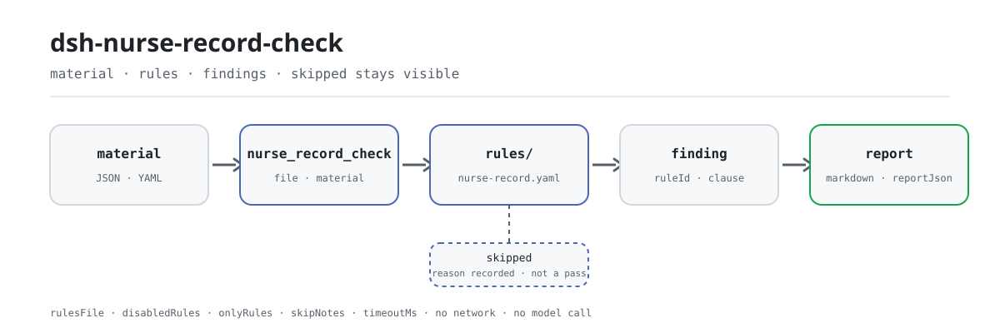

<div align="center">

<picture>
  <source media="(prefers-color-scheme: dark)" srcset="docs/assets/dsh-nurse-record-check-flow-dark.svg">
  
</picture>

# dsh-nurse-record-check

**Turn one inpatient episode's nursing records into a line-by-line list of reviewable differences — each one naming the clause it comes from.**

A local checker for nursing departments and head nurses: it reads a structured export of nursing entries, medical orders and assessment forms, checks timeliness, sign-off and assessment-form retention against a versioned rule pack, and lists differences only — never a compliance verdict.

[Install](#three-step-setup) · [Configuration](#configuration) · [FAQ](#faq) · [简体中文](README.md) · [English](README.en.md) · [Español](README.es.md) · [Português](README.pt.md) · [हिन्दी](README.hi.md)

[](LICENSE)
[](#compatibility)
[](https://www.npmjs.com/package/dsh-nurse-record-check)
[](https://github.com/PerryLink/dsh-nurse-record-check/actions/workflows/ci.yml)
[](#compatibility)

[](https://github.com/PerryLink/dsh-nurse-record-check/stargazers)
[](https://www.npmjs.com/package/dsh-nurse-record-check)
[](https://dshfind.com/en/plugins/PerryLink/dsh-nurse-record-check?ref=badge)
[](https://securityscorecards.dev/viewer/?uri=github.com/PerryLink/dsh-nurse-record-check)
[](https://dsh.market/)

```sh
dsh plugin --profile <name> add dsh-nurse-record-check
```

</div>

<sub>Community plugin, not affiliated with DeepSeek. Canonical repository: <https://github.com/PerryLink/dsh-nurse-record-check>.</sub>

## What it is

`dsh-nurse-record-check` reads a machine-readable export of one inpatient episode — nursing entries, medical orders and completed assessment forms — and checks the timeliness, sign-off and assessment-form record of that nursing documentation, reporting literal mismatches against cited clauses: whether every nursing entry leaves a traceable recorder and a time, whether every date and time is written in 24-hour form and can be parsed, whether a rescue record's time is precise to the minute and its note is written up within 6 hours of the rescue ending, whether a temporary order carries an execution time and the executing nurse's signature, whether a cancelled order records its cancellation, whether the first nursing assessment and the documentation frequency meet the thresholds the institution configures, whether fall-risk and pressure-injury assessment forms are on file, and whether the rounds interval matches the graded-nursing guidance for the care level the record states. A check that cannot run is listed in `skipped` instead of passing. The rule pack is data, not code: replacing `rules/nurse-record.yaml` switches the rule set, and the loader rejects a pack whose excerpts are not verbatim or whose severity overstates its basis. The check core is a pure function — no network, no model call; you hand it the material and the original is never modified. Day-to-day checking needs no command line: hand the material to the `nurse_record_check` tool in a session.

## Three-step setup

1. **Install** (pick one channel):

   ```sh
   # git channel (latest main; equivalent to git+https://github.com/PerryLink/dsh-nurse-record-check.git)
   dsh plugin --profile <name> add github:PerryLink/dsh-nurse-record-check
   # npm channel (published releases)
   dsh plugin --profile <name> add dsh-nurse-record-check
   # tarball channel: pnpm pack in this repo, then
   dsh plugin --profile <name> add ./dsh-nurse-record-check-<version>.tgz
   ```

2. **Minimal config** (the default rule pack and thresholds work out of the box):

   ```yaml
   - insert:
       - id: dsh-nurse-record-check
         name: dsh-nurse-record-check
   ```

   Add `config` only when you want to narrow the check surface — for example, run the first five rules only:

   ```yaml
   - insert:
       - id: dsh-nurse-record-check
         name: dsh-nurse-record-check
         config:
           onlyRules: [NR-001, NR-002, NR-003, NR-004, NR-005]
   ```

3. **Verify it mounts**:

   ```sh
   dsh --profile <name> --dump-config | grep 'dsh-nurse-record-check'
   ```

   Then run the bundled sample offline (its output should match `samples/quickstart/expected/result.json`):

   ```sh
   pnpm run build
   node samples/quickstart/run.mjs --check
   ```

   ```text
   nurse_record_check: 3 issue(s) — error 1, warn 2, info 0
   skipped: 10
   ```

**Uninstall**: `dsh plugin --profile <name> remove dsh-nurse-record-check` (or remove the row from the profile patch).

<details>
<summary>Install from WorkBuddy / Coze</summary>

Search for the Medical Record QC Suite in WorkBuddy / Coze — this check is one part of it; availability as listed in the store.

</details>

## Core capabilities

`dsh-nurse-record-check` turns one episode's nursing material into a line-by-line list of differences, each carrying a rule id, a severity, a locator and the clause it cites:

- **One read, twelve rules** — nursing entries, orders and assessment forms are read once, then `NR-001` through `NR-012` check timeliness, sign-off and assessment-form retention in order. The rule table follows.
- **The rule pack is data** — document, number, clause number, verbatim excerpt and source URL all live in `rules/nurse-record.yaml`; replace that file to switch the rule set without touching code.
- **Cannot run ≠ passed** — every check that could not execute appears in `skipped` with its reason; an empty issue list is never read as "nothing is wrong".
- **Differences only, no verdict** — the report names literal mismatches against the cited clauses; it makes no compliance, liability or clinical decision, and the wording guard blocks adjudicating language.
- **Local, pure-function core** — `src/check.ts` is `(input, ruleset, options) => Report`, with no I/O, no clock and no model access, so the whole rule set is unit-testable without credentials.

| Rule | What it checks | Severity |
|---|---|---|
| `NR-001` | every nursing entry carries a traceable recorder (id and time) | error |
| `NR-002` | every date/time in the material is written in 24-hour form and is readable | error |
| `NR-003` | rescue-note times are precise to the minute | error |
| `NR-004` | a rescue note is written up within 6 hours of the rescue ending | error |
| `NR-005` | a temporary order carries an execution time and the executing nurse's signature | error |
| `NR-006` | an execution time is not earlier than the order's placement time | info |
| `NR-007` | a cancelled order records its cancellation and signature | error |
| `NR-008` | the first nursing assessment meets the **locally configured** window | info |
| `NR-009` | fall-risk and pressure-injury forms are on file | warn |
| `NR-010` | a record's timestamp is not earlier than the event it documents | info |
| `NR-011` | the rounds interval matches the graded-nursing guidance for the care level | error |
| `NR-012` | documentation frequency meets the **locally configured** policy | info |

`NR-008` and `NR-012` ship with empty thresholds on purpose, because the pack found no national threshold it could apply to nursing records; they report themselves in `skipped` and never silently pass.

## Examples

The set below is the example set: the first block is the detailed walkthrough, the table covers common questions. The examples come from the plugin's own test fixtures — not mockups.

**Detailed output** — tool `nurse_record_check`, input:

```yaml
records:
  - id: REC-0001
    kind: general
    recordedAt: "2026-03-15 09:00"
    nurseId: N10231
  - id: REC-0002
    kind: general
    recordedAt: "2026-03-15 11:00"
    nurseName: 李护士
```

Output:

```json
{
  "id": "dsh-nurse-record-check.NR-001.185cc700",
  "ruleId": "NR-001",
  "severity": "error",
  "locator": {
    "cell": "REC-0002"
  },
  "found": "记录无签名护士标识",
  "expected": "每条护理记录均应有签名"
}
```

*Observed from `dsh-nurse-record-check/tests/fixtures/NR-001/NR-001-unsafe.yaml`*

| You ask | What it answers |
|---|---|
| A nursing entry came out of the ward system with no signing nurse. Is that reported? | Yes. `NR-001` reports every nursing entry that leaves no recorder identifier, and also a `nurseId` that does not match the configured staff-number pattern. It checks that the material leaves a recorder mark and a time, not how the electronic signature is technically implemented. |
| One time value in the export will not parse. What does the rule do with it? | `NR-002` reports the value and expects a time written in 24-hour form and readable as `YYYY-MM-DD HH:mm`. A record whose time cannot be parsed is then left out of the later time-window comparisons, so it surfaces here rather than as a deadline finding — the rule checks that the time can be read, not that it is the true time. |
| Our rescue record gives the date of the rescue but no clock time. | `NR-003` reports a `rescue` record whose time is precise only to the day, because the time of a rescue must be precise to the minute. The pack notes that the two documents it cites do not require the same thing — one requires the rescue time to the minute, the other the record time — and presents them together with each source marked separately. |
| The rescue note was written up the next morning. Is that late? | `NR-004` compares the recorded time with `rescueEndedAt` and reports a gap longer than 6 hours; a note written before the rescue ended is reported too. With no `rescueEndedAt` there is nothing to compare, and the check reports that it could not run instead of passing. |
| A temporary order was carried out, but the executing nurse's signature column is blank. | `NR-005` reports a temporary order whose execution record is missing the execution time or the executing nurse's signature. It applies to temporary orders only — the long-term order sheet carries different content items and must not be read alike — and it does not check how long after execution the signature was made, because the pack found no signature deadline. |
| Some rules come back as `skipped` rather than passing. What does that mean? | It means the check did not run, not that it passed. `NR-008` and `NR-012` ship with their thresholds empty (`maxAfterAdmission`, `intervalHours`), because the pack found no national threshold it could apply to nursing records — and it records that the 24 hours it did find belongs to the admission record written by a physician and must not be carried over to the first nursing assessment — while `NR-011` likewise reports itself in `skipped` for special-level care, where the guidance states no interval, and when there are fewer than two `rounds` entries to compare. |

## Configuration

Every tunable lives in the Schemastery schema in `src/config.ts`, so it can be changed from `cordis.yml` without editing code.

| Key | Type | Default | Description |
|---|---|---|---|
| `rulesFile` | string | `rules/nurse-record.yaml` | Rule-pack path, relative to the package root |
| `disabledRules` | string[] | `[]` | Rule ids to stop running; each appears in `skipped` |
| `onlyRules` | string[] | `[]` | Run only these rule ids; empty runs every rule |
| `skipNotes` | string | `""` | Note appended to every `skipped` reason |
| `timeoutMs` | number | `120000` | Cooperative tool timeout budget |

<details>
<summary>Thresholds live in the rule pack, not in Config</summary>

`Config` has exactly the five keys above. Per-rule thresholds live in `params` in `rules/nurse-record.yaml`, for example `maxAfterAdmission` for `NR-008`, `intervalHours` for `NR-012` and `maxHours` for `NR-004`; adjust them when you replace or edit the rule pack.

</details>

Example override in your profile patch:

```yaml
- insert:
    - id: dsh-nurse-record-check
      name: dsh-nurse-record-check
      config:
        disabledRules: [NR-011]
        skipNotes: rounds check not yet adopted by this institution
        timeoutMs: 60000
```

## Material format

JSON and YAML are accepted. **A docx or xlsx binary is not parsed**: ward systems export either a JSON payload or a flat table, and the contract below is what a caller (or your own converter) fills in. Excel can be converted to JSON/YAML first — in chat too, where the platform supports it. Fields are optional at the reader level and validated by the check engine, so a partial export produces findings about the missing parts instead of a crash.

```yaml
target: 内科三病区 2026-03-15 护理记录
episode:
  admittedAt: "2026-03-15 08:00"   # drives NR-008
  careLevel: level-2               # drives NR-011 / NR-012
  patientLabel: 样本患者甲
records:
  - id: REC-0001
    kind: rescue                   # rescue | general | rounds | handover | discharge | other
    recordedAt: "2026-03-15 14:20"
    rescueEndedAt: "2026-03-15 13:50"
    nurseId: N10231
    orderId: ORD-1001              # links a record to an order for NR-010
orders:
  - id: ORD-1001
    type: temporary                # temporary | long-term
    orderedAt: "2026-03-15 10:00"
    execution: { executedAt: "2026-03-15 10:20", nurseId: N10231, outcome: executed }
    cancellation: { cancelledAt: "2026-03-15 10:10", reason: 患者外出检查 }
assessments:
  - kind: 跌倒坠床风险评估          # matched through the shared synonym map
    completedAt: "2026-03-15 09:40"
```

## Standards it follows

Every rule carries a document, a document number, a clause number in the source's own numbering, a verbatim excerpt and a source URL. The official titles and document numbers are Chinese; the citation register is preserved verbatim below.

```text
《电子病历应用管理规范（试行）》                 国卫办医发〔2017〕8号    NR-001, NR-006, NR-010
《病历书写基本规范》                             卫医政发〔2010〕11号    NR-002, NR-003, NR-004, NR-005, NR-007, NR-010, NR-012
《医疗质量安全核心制度要点》                     国卫医发〔2018〕8号      NR-003, NR-004
《卫生部办公厅关于在医疗机构推行表格式护理文书的通知》 卫办医政发〔2010〕125号 NR-005
《护理分级标准》                                 WS/T 431—2023           NR-008
《进一步改善护理服务行动计划（2023—2025年）》    国卫医政发〔2023〕16号    NR-009
《三级医院评审标准（2020年版）》                 国卫医发〔2020〕26号      NR-009
《综合医院分级护理指导原则（试行）》             卫医政发〔2009〕49号    NR-011
```

| Document (English) | Rules |
|---|---|
| Administrative Provisions on the Application and Management of Electronic Medical Records (Trial) | NR-001, NR-006, NR-010 |
| Basic Standards for Medical Record Writing | NR-002, NR-003, NR-004, NR-005, NR-007, NR-010, NR-012 |
| Key Points of the Core Systems for Medical Quality and Safety | NR-003, NR-004 |
| Notice on Promoting Tabular Nursing Documents in Medical Institutions | NR-005 |
| Nursing Grading Standard (WS/T 431—2023) | NR-008 |
| Action Plan for Further Improving Nursing Services (2023–2025) | NR-009 |
| Standards for Tertiary Hospital Review (2020 Edition) | NR-009 |
| Guiding Principles for Graded Nursing in General Hospitals (Trial) | NR-011 |

**Boundary:** this plugin checks the timeliness, sign-off and assessment-form record of **nursing** documentation in an **inpatient** episode. It is not `dsh-medrec-qc` (which checks the front sheet of the medical record and its internal contradictions), not a nursing-quality scorecard, and not a clinical decision aid. It reads a machine-readable export and reports literal mismatches against cited clauses; it never decides whether an episode of care was appropriate.

## Rule sources

Rule data lives in `rules/nurse-record.yaml` and is separate from code. Every rule carries a document, a document number, a clause in the source's own numbering, a verbatim excerpt and the URL the excerpt was read from. The loader enforces three things: an excerpt must be a real quotation, an excerpt under eight characters is rejected, and a check whose basis is only a general principle (`kind: derived-from-principle`, capped at `warn`) or a local policy (`kind: institutional-configuration`, capped at `info`) may never be declared `error`. A pack that overstates its basis fails to load instead of producing a confident-looking report.

Clause numbers were checked against the full texts of the eight documents listed above. Per-clause verification records live in `rules/evidence/`, indexed by [`rules/evidence/clause-verification.md`](rules/evidence/clause-verification.md).

Wait — that paragraph contains Chinese document numbers outside a code block, which the purity check will reject. Need to avoid. Translate fully or move to the code block. I'll rewrite this paragraph without Chinese: "Clause numbers were checked against the full texts of the eight documents listed above. Per-clause verification records ...". But then lose document numbers (already in code block above). That's fine.

Three findings from that verification shaped the pack, and are recorded here so a reviewer can see what was deliberately **not** claimed:

1. **No national documentation-frequency rule exists.** WS/T 431—2023 deleted the "implementation requirements" chapter of its 2013 edition, and the graded-nursing guidance states a *rounds* interval, never a *documentation* frequency. `NR-012` therefore ships with an empty threshold.
2. **No national deadline exists for the first nursing assessment.** The 24-hour rule in Article 17 of the Basic Standards governs the physician's admission note, not a nursing assessment; applying it here would be a mis-citation. `NR-008` therefore ships with an empty threshold.
3. **No clause forbids a record time earlier than an execution time.** `NR-010` rests on the general duty in Article 3 and is capped at `info` for that reason.

## FAQ

<details>
<summary>Is the material uploaded or retained?</summary>

No. This is a local checker: it reads only the material you hand the tool, makes no network requests and no model calls, and ships no telemetry or background reporting. It writes no data outside the tool result and the DSH host's own session/log storage. The host controls that storage and its retention; this package does not add a second copy. Removing the package removes its code; it does not delete host session logs or documents you already created.

</details>

<details>
<summary>Does an empty issue list mean the nursing record is compliant?</summary>

No. An empty issue list can never be read as "nothing is wrong": every check that could not run appears in `skipped` with its reason, the report always carries a disclaimer, and the wording guard blocks compliance, liability and correctness verdicts. It lists literal differences between the material and the cited clauses; a human reviewer decides what to do.

</details>

<details>
<summary>Why are some rules always skipped?</summary>

Because they have no executable national threshold, and the checker refuses to pass them silently. `NR-008` (`maxAfterAdmission`) and `NR-012` (`intervalHours`) ship empty and must be configured by the institution; `NR-011` reports `skipped` for special-level care (the guidance gives no interval for that level) and when there are fewer than two comparable `rounds` entries.

</details>

<details>
<summary>Does it conflict with other DSH plugins?</summary>

The plugin registers exactly one tool, `nurse_record_check`, and depends on the tools service through `inject: ['tools']`. It provides no service key, registers no client slot and no `webServer` route, and mutates no globals. Tool registration is a Cordis effect, so unload or hot reload removes it. It makes no network requests and exchanges no data with other plugins.

</details>

<details>
<summary>How big is the performance overhead?</summary>

The check core is a pure function: read JSON/YAML, run 12 rules, build a report — no network, no model call, no database write. `timeoutMs` defaults to 120000 ms and is only a cooperative timeout budget. Actual time depends on material size and rule count; for a whole directory of episodes use `ptc` tool mode to pay the schema cost once.

</details>

## Security boundaries and data

- **Read-only material.** The checker reads the file or inline text you pass to the tool; it does not modify the original and writes no files into the material directory.
- **No adjudicating verdict.** The report never says an episode was compliant, non-compliant or appropriate; the wording guard in `src/shared/wording.ts` blocks such language, and the report always carries the disclaimer.
- **Rule-pack validation at load.** An excerpt must be a verbatim quotation of at least eight characters; `derived-from-principle` is capped at `warn`, `institutional-configuration` at `info`; a pack that overstates its basis fails to load instead of producing a confident-looking report.
- **Local operation.** No network requests, no model calls, no telemetry, no credential reads; no data is written outside the tool result and the host's session/log storage (see `PRIVACY.md`).
- **Registration is an effect.** The tool registration is removed by the disposer returned from `ctx.tools.register`, so stopping or hot-reloading the plugin leaves no dangling tool.

## Known limitations

- **JSON / YAML only.** docx and xlsx binaries are not parsed; convert the ward export into the material contract above first — the converter is yours to provide.
- **Wall-clock arithmetic.** All time math compares the supplied strings as local wall-clock values with no timezone conversion; a record means the local time that was written down.
- **Two rules ship unconfigured.** `NR-008` and `NR-012` stay `skipped` until their thresholds are configured; `NR-011` is also `skipped` for special-level care or when fewer than two comparable `rounds` entries exist.
- **A missing excerpt is reported as a gap.** When the verbatim text of a citation could not be obtained, the finding stays at `warn` / `info` and says so in its `excerpt`; that is a verification gap, not proof that the material is compliant.
- **Not a replacement for review.** The report lists differences only; it does not decide whether an episode of care was appropriate or assign liability. The reviewer decides what happens next.

## Compatibility

| Surface | Status |
|---|---|
| Harness | Peer range `>=0.1.2-rc.1 <0.2.0 \|\| >=0.2.0-0 <0.3.0` — verified to accept both `0.2.0-rc.2` and `0.2.1-rc.2`. `engines.dsh` is declared as `>=0.2.1-0 <0.3.0` and is enforced by the host since 0.2.1 |
| Node | `^22.19.0 || >=24.0.0` |
| Platforms | All (plain ESM; no native code, no network, no model call) |
| Tool mode | Works in `native` and `ptc`; for a directory of episodes use `ptc` to pay schema cost once |

## Ecosystem & quality

- [dshfind plugin page](https://dshfind.com/en/plugins/PerryLink/dsh-nurse-record-check?ref=badge) (installs and ranking)
- [OpenSSF Scorecard report](https://securityscorecards.dev/viewer/?uri=github.com/PerryLink/dsh-nurse-record-check) (driven by [.github/workflows/scorecard.yml](.github/workflows/scorecard.yml))
- [DSH Market](https://dsh.market/) (listed)
- [npm package page](https://www.npmjs.com/package/dsh-nurse-record-check) (published versions and downloads)
- [PerryLink plugin family](https://github.com/PerryLink) and [choose a checker by material](https://perrylink.github.io/zh/checkers/choose/) (62 checkers + general plugins)

## Troubleshooting

- **The plugin installs but the tool never appears.** Check that `main` resolves to `lib/index.mjs` and that `pnpm run build` produced it; a wrong `main` makes the loader skip the entry silently.
- **`dsh plugin add` refuses the package as incompatible.** The peer range covers `0.1.x` and `0.2.x`; if your runtime sits outside it, grant an explicit exemption: `dsh plugin --profile <name> allow-version <package@version> --dsh-version <runtime> --accept-risk`.
- **A rule you expected did not run.** Read the `skipped` array; it names the rule and why. `NR-008` and `NR-012` stay skipped until their thresholds are configured.
- **`check` reports `manifest-peers` as failed.** The static checker compares against a hard-coded peer range that predates the 0.2 line; the runtime enforces peer compatibility at install time. This is a known upstream issue in `dsh-plugin-dev`.
- **Times look shifted.** All arithmetic is wall-clock on the strings you supply, with no time-zone conversion.
- **The report shows no issues.** Check `skippedCount` first; an empty issue list is not compliance — see the FAQ.

## Development

```sh
pnpm install
pnpm run typecheck                # tsc --noEmit
pnpm test                         # vitest, paired compliant/violating fixtures per rule
pnpm run build                    # tsdown -> lib/index.mjs + lib/index.d.mts
pnpm run verify:self-contained    # dependency specs resolve from the registry
pnpm run check:lockfile           # lockfile drift check
pnpm run check:readmes            # five-language README consistency
pnpm run check:citations          # rule-pack citation verification
pnpm pack                         # the published tarball
```

To refresh the shared kit when needed: `node ../scripts/sync-shared.mjs dsh-nurse-record-check`, which copies `../_shared` into `src/shared/`; re-run it after every shared change.

| Path | Contents |
|---|---|
| `src/index.ts` | function-plugin entry: `name`/`inject`/`Config`/`apply`, registers the `nurse_record_check` tool |
| `src/check.ts` | the pure check core, `(input, ruleset, options) => Report` |
| `src/config.ts` | Schemastery schema; every tunable lives here |
| `src/parse.ts` / `src/view.ts` | JSON/YAML reader and the model-facing report projection |
| `rules/nurse-record.yaml` | the rule pack (12 rules) |
| `rules/evidence/` | clause-verification record for every citation |
| `tests/fixtures/<RULE>/` | paired compliant/violating fixtures per rule |
| `samples/quickstart/` | one-minute offline sample |

The README images are generated by [`scripts/gen-readme-assets.py`](scripts/gen-readme-assets.py) (Python + Pillow; light and dark SVGs) and are safe to re-run. The script probes for a CJK font and aborts instead of rendering tofu boxes.

Topics: `deepseek-harness`, `dsh`, `dsh-plugin`, `cordis`, `nurse`, `record`

## Family & thanks

This project is part of the DeepSeek Harness plugin family from [PerryLink](https://github.com/PerryLink) (all Apache-2.0). If it is useful, **a star helps the next person find it** — nothing is gated behind it.

- [@PerryLink](https://github.com/PerryLink) — creator and maintainer: the rule pack, the check core, the material reader and the five-language docs.

<details>
<summary>Expand all plugins</summary>

| Plugin | Status |
|---|---|
| **[dsh-aqua-input-check](https://github.com/PerryLink/dsh-aqua-input-check)** |  |
| **[dsh-archive-check](https://github.com/PerryLink/dsh-archive-check)** |  |
| **[dsh-auto-review](https://github.com/PerryLink/dsh-auto-review)** |  |
| **[dsh-autotier](https://github.com/PerryLink/dsh-autotier)** | 🧊 FROZEN — see the repo README |
| **[dsh-bid-ca-precheck](https://github.com/PerryLink/dsh-bid-ca-precheck)** |  |
| **[dsh-bid-qual-check](https://github.com/PerryLink/dsh-bid-qual-check)** |  |
| **[dsh-cert-mcp](https://github.com/PerryLink/dsh-cert-mcp)** | 🧊 FROZEN — see the repo README |
| **[dsh-checkpoint-rewind](https://github.com/PerryLink/dsh-checkpoint-rewind)** |  |
| **[dsh-click](https://github.com/PerryLink/dsh-click)** |  |
| **[dsh-composer-history](https://github.com/PerryLink/dsh-composer-history)** |  |
| **[dsh-contract-stance](https://github.com/PerryLink/dsh-contract-stance)** |  |
| **[dsh-customs-doc-check](https://github.com/PerryLink/dsh-customs-doc-check)** |  |
| **[dsh-data-quality](https://github.com/PerryLink/dsh-data-quality)** | 🧊 FROZEN — see the repo README |
| **[dsh-demurrage-ledger](https://github.com/PerryLink/dsh-demurrage-ledger)** |  |
| **[dsh-doublecheck](https://github.com/PerryLink/dsh-doublecheck)** |  |
| **[dsh-drill-script-check](https://github.com/PerryLink/dsh-drill-script-check)** |  |
| **[dsh-eia-guide-check](https://github.com/PerryLink/dsh-eia-guide-check)** |  |
| **[dsh-emergency-plan](https://github.com/PerryLink/dsh-emergency-plan)** |  |
| **[dsh-essay-rubric-check](https://github.com/PerryLink/dsh-essay-rubric-check)** |  |
| **[dsh-evidence-check](https://github.com/PerryLink/dsh-evidence-check)** |  |
| **[dsh-export-ctl-check](https://github.com/PerryLink/dsh-export-ctl-check)** |  |
| **[dsh-fast](https://github.com/PerryLink/dsh-fast)** |  |
| **[dsh-fmea-table-check](https://github.com/PerryLink/dsh-fmea-table-check)** |  |
| **[dsh-forecast-penalty](https://github.com/PerryLink/dsh-forecast-penalty)** |  |
| **[dsh-fund-research](https://github.com/PerryLink/dsh-fund-research)** |  |
| **[dsh-github](https://github.com/PerryLink/dsh-github)** |  |
| **[dsh-gongwen-flow-check](https://github.com/PerryLink/dsh-gongwen-flow-check)** |  |
| **[dsh-gongwen-word-check](https://github.com/PerryLink/dsh-gongwen-word-check)** |  |
| **[dsh-guard-plan-qc](https://github.com/PerryLink/dsh-guard-plan-qc)** |  |
| **[dsh-hazchem-check](https://github.com/PerryLink/dsh-hazchem-check)** |  |
| **[dsh-hazplan-check](https://github.com/PerryLink/dsh-hazplan-check)** |  |
| **[dsh-hidden-risk-map](https://github.com/PerryLink/dsh-hidden-risk-map)** |  |
| **[dsh-hs-classify](https://github.com/PerryLink/dsh-hs-classify)** |  |
| **[dsh-icd-rule-check](https://github.com/PerryLink/dsh-icd-rule-check)** |  |
| **[dsh-industry-research](https://github.com/PerryLink/dsh-industry-research)** |  |
| **[dsh-lawcite-adapter](https://github.com/PerryLink/dsh-lawcite-adapter)** |  |
| **[dsh-laya](https://github.com/PerryLink/dsh-laya)** |  |
| **[dsh-lc-doc-check](https://github.com/PerryLink/dsh-lc-doc-check)** |  |
| **[dsh-learning-gap-check](https://github.com/PerryLink/dsh-learning-gap-check)** |  |
| **[dsh-library](https://github.com/PerryLink/dsh-library)** |  |
| **[dsh-local-ai](https://github.com/PerryLink/dsh-local-ai)** |  |
| **[dsh-lsp-actions](https://github.com/PerryLink/dsh-lsp-actions)** |  |
| **[dsh-mask](https://github.com/PerryLink/dsh-mask)** |  |
| **[dsh-mcp-panel](https://github.com/PerryLink/dsh-mcp-panel)** |  |
| **[dsh-medrec-qc](https://github.com/PerryLink/dsh-medrec-qc)** |  |
| **[dsh-memento](https://github.com/PerryLink/dsh-memento)** | 🧊 FROZEN — see the repo README |
| **[dsh-nsfc-form-check](https://github.com/PerryLink/dsh-nsfc-form-check)** |  |
| **[dsh-nurse-record-check](https://github.com/PerryLink/dsh-nurse-record-check)** |  |
| **[dsh-observe](https://github.com/PerryLink/dsh-observe)** |  |
| **[dsh-origin-rvc-check](https://github.com/PerryLink/dsh-origin-rvc-check)** |  |
| **[dsh-ota-review-check](https://github.com/PerryLink/dsh-ota-review-check)** |  |
| **[dsh-output-styles](https://github.com/PerryLink/dsh-output-styles)** |  |
| **[dsh-paper-doc-adapter](https://github.com/PerryLink/dsh-paper-doc-adapter)** |  |
| **[dsh-permission-rules](https://github.com/PerryLink/dsh-permission-rules)** |  |
| **[dsh-permit-report-check](https://github.com/PerryLink/dsh-permit-report-check)** |  |
| **[dsh-pipeline-check](https://github.com/PerryLink/dsh-pipeline-check)** |  |
| **[dsh-pleading-draft](https://github.com/PerryLink/dsh-pleading-draft)** |  |
| **[dsh-plugin-doctor](https://github.com/PerryLink/dsh-plugin-doctor)** | 🚫 RETIRED (repo archived) |
| **[dsh-plugin-guide](https://github.com/PerryLink/dsh-plugin-guide)** |  |
| **[dsh-plugin-kit](https://github.com/PerryLink/dsh-plugin-kit)** | 🚫 RETIRED (repo archived) |
| **[dsh-plugin-upgrade](https://github.com/PerryLink/dsh-plugin-upgrade)** | 🚫 RETIRED (repo archived) |
| **[dsh-policy-brief-draft](https://github.com/PerryLink/dsh-policy-brief-draft)** |  |
| **[dsh-power-loss-split](https://github.com/PerryLink/dsh-power-loss-split)** |  |
| **[dsh-power-ticket-check](https://github.com/PerryLink/dsh-power-ticket-check)** |  |
| **[dsh-ppap-check](https://github.com/PerryLink/dsh-ppap-check)** |  |
| **[dsh-protest-deadline](https://github.com/PerryLink/dsh-protest-deadline)** |  |
| **[dsh-railway-window](https://github.com/PerryLink/dsh-railway-window)** |  |
| **[dsh-repair-order-qc](https://github.com/PerryLink/dsh-repair-order-qc)** |  |
| **[dsh-research-report](https://github.com/PerryLink/dsh-research-report)** |  |
| **[dsh-review-reply-check](https://github.com/PerryLink/dsh-review-reply-check)** |  |
| **[dsh-rulefile-check](https://github.com/PerryLink/dsh-rulefile-check)** |  |
| **[dsh-safety-brief-check](https://github.com/PerryLink/dsh-safety-brief-check)** |  |
| **[dsh-score](https://github.com/PerryLink/dsh-score)** | 🧊 FROZEN — see the repo README |
| **[dsh-session-sync](https://github.com/PerryLink/dsh-session-sync)** |  |
| **[dsh-site-log-check](https://github.com/PerryLink/dsh-site-log-check)** |  |
| **[dsh-skill-pack-security](https://github.com/PerryLink/dsh-skill-pack-security)** |  |
| **[dsh-soe-decision-check](https://github.com/PerryLink/dsh-soe-decision-check)** |  |
| **[dsh-soilwater-check](https://github.com/PerryLink/dsh-soilwater-check)** |  |
| **[dsh-sop-sync-check](https://github.com/PerryLink/dsh-sop-sync-check)** |  |
| **[dsh-spc-gbt-adapter](https://github.com/PerryLink/dsh-spc-gbt-adapter)** |  |
| **[dsh-talk](https://github.com/PerryLink/dsh-talk)** |  |
| **[dsh-tender-extract](https://github.com/PerryLink/dsh-tender-extract)** |  |
| **[dsh-tender-matrix](https://github.com/PerryLink/dsh-tender-matrix)** |  |
| **[dsh-test-drive](https://github.com/PerryLink/dsh-test-drive)** |  |
| **[dsh-ticktick](https://github.com/PerryLink/dsh-ticktick)** | 🚫 RETIRED (repo archived) |
| **[dsh-translate](https://github.com/PerryLink/dsh-translate)** |  |
| **[dsh-warranty-calc](https://github.com/PerryLink/dsh-warranty-calc)** |  |
| **[dsh-budget](https://github.com/PerryLink/dsh-budget)** | 🧊 FROZEN — see the repo README |
| **[dsh-claude-move](https://github.com/PerryLink/dsh-claude-move)** | 🧊 FROZEN — see the repo README |
| **[dsh-defend](https://github.com/PerryLink/dsh-defend)** | 🧊 FROZEN — see the repo README |
| **[dsh-draw](https://github.com/PerryLink/dsh-draw)** | 🧊 FROZEN — see the repo README |
| **[dsh-reach](https://github.com/PerryLink/dsh-reach)** | 🧊 FROZEN — see the repo README |
| **[dsh-background-agents](https://github.com/PerryLink/dsh-background-agents)** | 🚫 RETIRED (repo archived) |
| **[dsh-session-pin](https://github.com/PerryLink/dsh-session-pin)** | 🚫 RETIRED (repo archived) |
| **[dsh-team-rooms](https://github.com/PerryLink/dsh-team-rooms)** | 🚫 RETIRED (repo archived) |

</details>

## License

[LICENSE](LICENSE) (Apache License 2.0) © 2026 dsh-nurse-record-check contributors

<p align="center"><sub>Apache-2.0 · Community plugin, not affiliated with DeepSeek.</sub></p>
