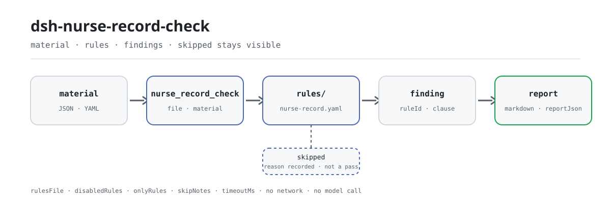

<div align="center">

<picture>
  <source media="(prefers-color-scheme: dark)" srcset="docs/assets/dsh-nurse-record-check-flow-dark.svg">
  
</picture>

# dsh-nurse-record-check

**Convierte el registro de enfermería de un episodio de hospitalización en una lista de diferencias revisables línea por línea, cada una con la cláusula que la respalda.**

Un verificador local para departamentos de enfermería y supervisoras: lee una exportación estructurada de registros de enfermería, órdenes médicas y formularios de evaluación, comprueba plazos, firmas y conservación de formularios contra un paquete de reglas versionado, y solo lista diferencias, nunca un veredicto de cumplimiento.

[Instalar](#instalación-en-tres-pasos) · [Configuración](#configuración) · [FAQ](#faq) · [简体中文](README.md) · [English](README.en.md) · [Español](README.es.md) · [Português](README.pt.md) · [हिन्दी](README.hi.md)

[](LICENSE)
[](#compatibilidad)
[](https://www.npmjs.com/package/dsh-nurse-record-check)
[](https://github.com/PerryLink/dsh-nurse-record-check/actions/workflows/ci.yml)
[](#compatibilidad)

[](https://github.com/PerryLink/dsh-nurse-record-check/stargazers)
[](https://www.npmjs.com/package/dsh-nurse-record-check)
[](https://dshfind.com/en/plugins/PerryLink/dsh-nurse-record-check?ref=badge)
[](https://securityscorecards.dev/viewer/?uri=github.com/PerryLink/dsh-nurse-record-check)
[](https://dsh.market/)

```sh
dsh plugin --profile <name> add dsh-nurse-record-check
```

</div>

<sub>Plugin de la comunidad, no afiliado a DeepSeek. Repositorio canónico: <https://github.com/PerryLink/dsh-nurse-record-check>.</sub>

## Qué es

`dsh-nurse-record-check` lee una exportación legible por máquina de un episodio de hospitalización —registros de enfermería, órdenes médicas y formularios de evaluación completados— y comprueba los plazos, las firmas y la conservación de formularios de esa documentación de enfermería, informando de las diferencias literales frente a las cláusulas citadas: que cada registro de enfermería deje un responsable y una hora trazables, que toda fecha y hora esté escrita en formato de 24 horas y se pueda leer, que la hora de un registro de reanimación sea precisa al minuto y su nota se escriba dentro de las 6 horas siguientes al final de la reanimación, que una orden temporal lleve hora de ejecución y la firma de la enfermera que la ejecutó y que una orden anulada registre su anulación, que la primera evaluación de enfermería y la frecuencia de documentación cumplan los umbrales que configure la institución, que los formularios de riesgo de caídas y de lesión por presión estén archivados, y que el intervalo entre rondas de vigilancia corresponda a la guía de cuidados graduados del nivel de cuidados que el registro indica. Una comprobación que no puede ejecutarse se lista en `skipped` en lugar de pasar. El paquete de reglas es dato, no código: sustituir `rules/nurse-record.yaml` cambia el conjunto de reglas, y el cargador rechaza un paquete cuyos extractos no sean literales o cuya severidad exagere su base. El núcleo de la comprobación es una función pura —sin red ni llamada al modelo—: usted entrega el material y el original nunca se modifica. La comprobación diaria no requiere línea de comandos: entregue el material a la herramienta `nurse_record_check` en una sesión.

## Instalación en tres pasos

1. **Instalar** (elija un canal):

   ```sh
   # canal git (último main; equivalente a git+https://github.com/PerryLink/dsh-nurse-record-check.git)
   dsh plugin --profile <name> add github:PerryLink/dsh-nurse-record-check
   # canal npm (versiones publicadas)
   dsh plugin --profile <name> add dsh-nurse-record-check
   # canal tarball: pnpm pack en este repo y luego
   dsh plugin --profile <name> add ./dsh-nurse-record-check-<version>.tgz
   ```

2. **Configuración mínima** (el paquete de reglas y los umbrales por defecto funcionan de fábrica):

   ```yaml
   - insert:
       - id: dsh-nurse-record-check
         name: dsh-nurse-record-check
   ```

   Añada `config` solo para acotar la superficie de comprobación; por ejemplo, ejecutar solo las cinco primeras reglas:

   ```yaml
   - insert:
       - id: dsh-nurse-record-check
         name: dsh-nurse-record-check
         config:
           onlyRules: [NR-001, NR-002, NR-003, NR-004, NR-005]
   ```

3. **Verificar que se monta**:

   ```sh
   dsh --profile <name> --dump-config | grep 'dsh-nurse-record-check'
   ```

   Después ejecute el ejemplo incluido sin conexión (su salida debe coincidir con `samples/quickstart/expected/result.json`):

   ```sh
   pnpm run build
   node samples/quickstart/run.mjs --check
   ```

   ```text
   nurse_record_check: 3 issue(s) — error 1, warn 2, info 0
   skipped: 10
   ```

**Desinstalar**: `dsh plugin --profile <name> remove dsh-nurse-record-check` (o elimine la fila del patch del perfil).

<details>
<summary>Instalar desde WorkBuddy / Coze</summary>

Busque Medical Record QC Suite en WorkBuddy / Coze: esta comprobación es una de sus partes; la disponibilidad es la que figure en la tienda.

</details>

## Capacidades clave

`dsh-nurse-record-check` convierte el material de enfermería de un episodio en una lista de diferencias revisables, cada una con id de regla, severidad, localizador y la cláusula que cita:

- **Una lectura, doce reglas** — los registros, las órdenes y los formularios de evaluación se leen una vez; después `NR-001` a `NR-012` comprueban plazos, firmas y conservación de formularios en orden. La tabla de reglas va a continuación.
- **El paquete de reglas es dato** — documento, número, cláusula, extracto literal y URL de origen viven en `rules/nurse-record.yaml`; sustituya ese archivo para cambiar el conjunto de reglas sin tocar el código.
- **No poder ejecutarse no es pasar** — toda comprobación que no pudo ejecutarse aparece en `skipped` con su motivo; una lista de problemas vacía nunca se lee como «no falta nada».
- **Solo diferencias, sin veredicto** — el informe nombra discrepancias literales frente a las cláusulas citadas; no dictamina cumplimiento, responsabilidad ni decisión clínica, y el guardián de redacción bloquea ese lenguaje.
- **Núcleo local y de función pura** — `src/check.ts` es `(input, ruleset, options) => Report`, sin E/S, sin reloj y sin acceso al modelo, así que todo el conjunto de reglas se puede probar sin credenciales.

| Regla | Qué comprueba | Severidad |
|---|---|---|
| `NR-001` | cada registro de enfermería deja un responsable trazable (id y hora) | error |
| `NR-002` | toda fecha y hora del material está en formato de 24 horas y se puede leer | error |
| `NR-003` | la hora de la nota de reanimación es precisa al minuto | error |
| `NR-004` | la nota de reanimación se escribe dentro de las 6 horas siguientes al final de la reanimación | error |
| `NR-005` | una orden temporal lleva hora de ejecución y la firma de la enfermera que la ejecutó | error |
| `NR-006` | la hora de ejecución no es anterior a la hora de prescripción de la orden | info |
| `NR-007` | una orden anulada registra su anulación y firma | error |
| `NR-008` | la primera evaluación de enfermería cumple la ventana **configurada localmente** | info |
| `NR-009` | los formularios de riesgo de caídas y de lesión por presión están archivados | warn |
| `NR-010` | la marca de tiempo de un registro no es anterior al evento que documenta | info |
| `NR-011` | el intervalo de rondas coincide con la guía de cuidados graduados del nivel de cuidados | error |
| `NR-012` | la frecuencia de documentación cumple la política **configurada localmente** | info |

`NR-008` y `NR-012` salen de fábrica con los umbrales vacíos a propósito, porque el paquete no encontró ningún umbral nacional aplicable a los registros de enfermería; se informan a sí mismos en `skipped` y nunca pasan en silencio.

## Ejemplos

El conjunto siguiente es el conjunto de ejemplos: el primer bloque es el caso detallado y la tabla cubre preguntas frecuentes. Los ejemplos proceden de los propios fixtures de prueba del plugin, no son simulaciones.

**Salida detallada** — herramienta `nurse_record_check`, entrada:

```yaml
records:
  - id: REC-0001
    kind: general
    recordedAt: "2026-03-15 09:00"
    nurseId: N10231
  - id: REC-0002
    kind: general
    recordedAt: "2026-03-15 11:00"
    nurseName: 李护士
```

Salida:

```json
{
  "id": "dsh-nurse-record-check.NR-001.185cc700",
  "ruleId": "NR-001",
  "severity": "error",
  "locator": {
    "cell": "REC-0002"
  },
  "found": "记录无签名护士标识",
  "expected": "每条护理记录均应有签名"
}
```

*Observado en `dsh-nurse-record-check/tests/fixtures/NR-001/NR-001-unsafe.yaml`*

| Usted pregunta | Qué responde |
|---|---|
| Un registro de enfermería salió del sistema de planta sin enfermera firmante. ¿Se informa de ello? | Sí. `NR-001` informa de todo registro de enfermería que no deja un identificador de responsable y también de un `nurseId` que no coincide con el formato de número de personal configurado. Comprueba que el material deje una marca de responsable y una hora, no cómo se implementa técnicamente la firma electrónica. |
| Un valor de hora de la exportación no se puede analizar. ¿Qué hace la regla con él? | `NR-002` informa del valor y exige una hora escrita en formato de 24 horas y legible como `YYYY-MM-DD HH:mm`. El registro cuya hora no se puede analizar queda fuera de las comparaciones de plazo posteriores, así que aparece aquí y no como una diferencia de plazo: la regla comprueba que la hora se pueda leer, no que sea la hora real. |
| Nuestro registro de reanimación indica la fecha, pero ninguna hora. | `NR-003` informa de un registro de tipo `rescue` cuya hora solo es precisa al día, porque la hora de la reanimación debe ser precisa al minuto. El paquete señala que las dos disposiciones que cita no piden lo mismo —una exige la hora de reanimación al minuto y la otra la hora de registro— y las presenta juntas indicando cada fuente por separado. |
| La nota de reanimación se escribió a la mañana siguiente. ¿Es tarde? | `NR-004` compara la hora registrada con `rescueEndedAt` e informa de un intervalo superior a 6 horas; también informa de una nota escrita antes de que terminara la reanimación. Si falta `rescueEndedAt` no hay nada que comparar, y la comprobación informa de que no pudo ejecutarse en lugar de pasar. |
| Se ejecutó una orden temporal, pero la casilla de firma de la enfermera que la ejecutó está vacía. | `NR-005` informa de una orden temporal cuyo registro de ejecución carece de la hora de ejecución o de la firma de la enfermera que la ejecutó. Se aplica solo a las órdenes temporales —la hoja de órdenes de largo plazo contiene otros elementos y no debe leerse igual— y no comprueba cuánto después de la ejecución se firmó, porque el paquete no encontró ningún plazo de firma. |
| Algunas reglas aparecen como `skipped` en lugar de pasar. ¿Qué significa? | Significa que la comprobación no se ejecutó, no que haya pasado. `NR-008` y `NR-012` traen sus umbrales vacíos (`maxAfterAdmission`, `intervalHours`), porque el paquete no encontró ningún umbral nacional aplicable a los registros de enfermería —y deja constancia de que las 24 horas que sí encontró corresponden al registro de ingreso que escribe el médico y no deben trasladarse a la primera evaluación de enfermería—; `NR-011` también se informa como `skipped` en cuidados especiales, donde la guía no fija intervalo, y cuando hay menos de dos registros de `rounds` que comparar. |

## Configuración

Todos los parámetros ajustables viven en el esquema Schemastery de `src/config.ts`, por lo que se cambian desde `cordis.yml` sin tocar el código.

| Clave | Tipo | Predeterminado | Descripción |
|---|---|---|---|
| `rulesFile` | string | `rules/nurse-record.yaml` | Ruta del paquete de reglas, relativa a la raíz del paquete |
| `disabledRules` | string[] | `[]` | Ids de reglas que se dejan de ejecutar; cada una aparece en `skipped` |
| `onlyRules` | string[] | `[]` | Ejecutar solo estas reglas; vacío ejecuta todas |
| `skipNotes` | string | `""` | Nota añadida a cada motivo de `skipped` |
| `timeoutMs` | number | `120000` | Presupuesto de tiempo de espera cooperativo de la herramienta |

<details>
<summary>Los umbrales viven en el paquete de reglas, no en Config</summary>

`Config` tiene exactamente las cinco claves de arriba. Los umbrales por regla viven en `params` dentro de `rules/nurse-record.yaml`, por ejemplo `maxAfterAdmission` para `NR-008`, `intervalHours` para `NR-012` y `maxHours` para `NR-004`; ajústelos al sustituir o editar el paquete de reglas.

</details>

Ejemplo de sobrescritura en el patch del perfil:

```yaml
- insert:
    - id: dsh-nurse-record-check
      name: dsh-nurse-record-check
      config:
        disabledRules: [NR-011]
        skipNotes: la institución aún no adopta la comprobación de rondas
        timeoutMs: 60000
```

## Formato del material

Se aceptan JSON y YAML. **Un binario docx o xlsx no se analiza**: los sistemas de planta exportan una carga JSON o una tabla plana, y el contrato siguiente es lo que rellena quien llama (o su propio conversor). Excel puede convertirse antes a JSON/YAML, también en el chat cuando la plataforma lo permita. Los campos son opcionales en la capa de lectura y los valida el motor, de modo que una exportación parcial produce hallazgos sobre lo que falta en lugar de un fallo.

```yaml
target: 内科三病区 2026-03-15 护理记录
episode:
  admittedAt: "2026-03-15 08:00"   # alimenta NR-008
  careLevel: level-2               # alimenta NR-011 / NR-012
  patientLabel: 样本患者甲
records:
  - id: REC-0001
    kind: rescue                   # rescue | general | rounds | handover | discharge | other
    recordedAt: "2026-03-15 14:20"
    rescueEndedAt: "2026-03-15 13:50"
    nurseId: N10231
    orderId: ORD-1001              # vincula un registro a una orden para NR-010
orders:
  - id: ORD-1001
    type: temporary                # temporary | long-term
    orderedAt: "2026-03-15 10:00"
    execution: { executedAt: "2026-03-15 10:20", nurseId: N10231, outcome: executed }
    cancellation: { cancelledAt: "2026-03-15 10:10", reason: 患者外出检查 }
assessments:
  - kind: 跌倒坠床风险评估          # se empareja mediante el mapa de sinónimos compartido
    completedAt: "2026-03-15 09:40"
```

## Normas que sigue

| Documento | Número | Reglas que lo citan |
|---|---|---|
| 《电子病历应用管理规范（试行）》 | 国卫办医发〔2017〕8号 | NR-001, NR-006, NR-010 |
| 《病历书写基本规范》 | 卫医政发〔2010〕11号 | NR-002, NR-003, NR-004, NR-005, NR-007, NR-010, NR-012 |
| 《医疗质量安全核心制度要点》 | 国卫医发〔2018〕8号 | NR-003, NR-004 |
| 《卫生部办公厅关于在医疗机构推行表格式护理文书的通知》 | 卫办医政发〔2010〕125号 | NR-005 |
| 《护理分级标准》 | WS/T 431—2023（全部代替 WS/T 431—2013；推荐性卫生行业标准，2024-02-01 施行） | NR-008 |
| 《进一步改善护理服务行动计划（2023—2025年）》 | 国卫医政发〔2023〕16号 | NR-009 |
| 《三级医院评审标准（2020年版）》 | 国卫医发〔2020〕26号 | NR-009 |
| 《综合医院分级护理指导原则（试行）》 | 卫医政发〔2009〕49号 | NR-011 |

**Límite:** este plugin comprueba la puntualidad, la firma y el registro de formularios de evaluación de la documentación de **enfermería** en un episodio de **hospitalización**. No es `dsh-medrec-qc` (que comprueba la hoja de portada del historial médico y sus contradicciones internas), no es una tarjeta de puntuación de calidad de enfermería ni una ayuda a la decisión clínica. Lee una exportación legible por máquina e informa de discrepancias literales frente a las cláusulas citadas; nunca decide si un episodio de atención fue apropiado.

## Fuentes de las reglas

Los datos de las reglas están separados del código: cada regla lleva documento, número, cláusula en la numeración propia de la fuente, extracto literal y URL de origen. El cargador impone tres cosas: el extracto debe ser una cita real, se rechaza un extracto de menos de ocho caracteres, y una comprobación basada solo en un principio general (`kind: derived-from-principle`, tope `warn`) o en una política local (`kind: institutional-configuration`, tope `info`) nunca puede declararse `error`. Un paquete que exagera su base falla al cargar en lugar de producir un informe que parezca sólido.

Los números de cláusula se verificaron contra los textos completos de los ocho documentos enumerados arriba. Los registros de verificación por cláusula están en `rules/evidence/`, con índice en [`rules/evidence/clause-verification.md`](rules/evidence/clause-verification.md).

Tres hallazgos de esa verificación dieron forma al paquete y se registran aquí para que un revisor vea lo que deliberadamente **no** se afirmó:

1. **No existe una regla nacional de frecuencia de documentación.** WS/T 431—2023 eliminó el capítulo de «requisitos de implementación» de su edición de 2013, y la guía de cuidados graduados fija un intervalo de *rondas*, nunca una frecuencia de *documentación*. Por eso `NR-012` sale con el umbral vacío.
2. **No existe un plazo nacional para la primera evaluación de enfermería.** La regla de 24 horas del artículo 17 de las Normas básicas regula la nota de ingreso del médico, no una evaluación de enfermería; aplicarla aquí sería una cita errónea. Por eso `NR-008` sale con el umbral vacío.
3. **Ninguna cláusula prohíbe que la hora de registro sea anterior a la de ejecución.** `NR-010` se apoya en el deber general del artículo 3 y por eso tiene el tope `info`.

## FAQ

<details>
<summary>¿Se sube o se conserva el material?</summary>

No. Es un verificador local: solo lee el material que usted entrega a la herramienta, no hace peticiones de red ni llamadas al modelo, y no incluye telemetría ni informes en segundo plano. No escribe datos fuera del resultado de la herramienta y del almacenamiento de sesión/registros del propio host DSH. El host controla ese almacenamiento y su retención; este paquete no añade una segunda copia. Desinstalar el paquete elimina su código; no borra los registros de sesión del host ni los documentos que usted ya creó.

</details>

<details>
<summary>¿Una lista de problemas vacía significa que el registro de enfermería cumple?</summary>

No. Una lista vacía nunca puede leerse como «no falta nada»: toda comprobación que no pudo ejecutarse aparece en `skipped` con su motivo, el informe siempre lleva un descargo de responsabilidad y el guardián de redacción bloquea los veredictos de cumplimiento, responsabilidad y corrección. Solo enumera diferencias literales entre el material y las cláusulas citadas; un revisor humano decide qué hacer.

</details>

<details>
<summary>¿Por qué algunas reglas siempre aparecen como skipped?</summary>

Porque no tienen un umbral nacional ejecutable y el verificador se niega a pasarlas en silencio. `NR-008` (`maxAfterAdmission`) y `NR-012` (`intervalHours`) salen vacías y debe configurarlas la institución; `NR-011` informa `skipped` en cuidados especiales (la guía no da intervalo para ese nivel) y cuando hay menos de dos registros de `rounds` comparables.

</details>

<details>
<summary>¿Entra en conflicto con otros plugins de DSH?</summary>

El plugin registra exactamente una herramienta, `nurse_record_check`, y depende del servicio tools mediante `inject: ['tools']`. No provee ninguna clave de servicio, no registra slots de cliente ni rutas `webServer`, y no muta globales. El registro de la herramienta es un efecto Cordis, así que descargar o recargar en caliente lo retira. No hace peticiones de red ni intercambia datos con otros plugins.

</details>

<details>
<summary>¿Cuánto coste de rendimiento supone?</summary>

El núcleo es una función pura: leer JSON/YAML, ejecutar 12 reglas y construir un informe, sin red, sin llamada al modelo y sin escritura en base de datos. `timeoutMs` vale 120000 ms por defecto y es solo un presupuesto de tiempo de espera cooperativo. El tiempo real depende del tamaño del material y del número de reglas; para un directorio completo de episodios use el modo de herramienta `ptc` y pague el coste de esquema una sola vez.

</details>

## Límites de seguridad y datos

- **Material de solo lectura.** El verificador lee el archivo o el texto en línea que usted pasa a la herramienta; no modifica el original ni escribe archivos en el directorio del material.
- **Sin veredicto.** El informe nunca dice que un episodio sea conforme, no conforme o apropiado; el guardián de redacción de `src/shared/wording.ts` bloquea ese lenguaje y el informe siempre lleva el descargo.
- **Validación del paquete al cargar.** El extracto debe ser una cita literal de al menos ocho caracteres; `derived-from-principle` tiene tope `warn` y `institutional-configuration` tope `info`; un paquete que exagera su base falla al cargar en lugar de producir un informe que parezca sólido.
- **Funcionamiento local.** Sin peticiones de red, sin llamadas al modelo, sin telemetría, sin lectura de credenciales; no se escribe nada fuera del resultado de la herramienta y del almacenamiento de sesión/registros del host (véase `PRIVACY.md`).
- **El registro es un efecto.** El registro de la herramienta lo retira el disposer que devuelve `ctx.tools.register`, así que detener o recargar el plugin no deja herramientas colgadas.

## Limitaciones conocidas

- **Solo JSON / YAML.** Los binarios docx y xlsx no se analizan; convierta antes la exportación de planta al contrato de material de arriba; el conversor corre de su cuenta.
- **Aritmética de reloj de pared.** Toda la aritmética temporal compara las cadenas suministradas como hora local, sin conversión de zona horaria; un registro significa la hora local que se escribió.
- **Dos reglas salen sin configurar.** `NR-008` y `NR-012` permanecen en `skipped` hasta que se configuren sus umbrales; `NR-011` también queda en `skipped` en cuidados especiales o cuando hay menos de dos registros de `rounds` comparables.
- **Un extracto ausente se informa como hueco.** Cuando no se pudo obtener el texto literal de una cita, el hallazgo se queda en `warn` / `info` y lo dice en su `excerpt`; eso es un hueco de verificación, no una prueba de que el material cumpla.
- **No sustituye la revisión.** El informe solo enumera diferencias; no decide si un episodio de atención fue apropiado ni atribuye responsabilidad. El revisor decide qué hacer después.

## Compatibilidad

| Superficie | Estado |
|---|---|
| Harness | Rango de peers `>=0.1.2-rc.1 <0.2.0 \|\| >=0.2.0-0 <0.3.0` — verificado para aceptar tanto `0.2.0-rc.2` como `0.2.1-rc.2`. `engines.dsh` se declara como `>=0.2.1-0 <0.3.0` y el host lo aplica desde 0.2.1 |
| Node | `^22.19.0 || >=24.0.0` |
| Plataformas | Todas (ESM puro; sin código nativo, sin red, sin llamada al modelo) |
| Modo de herramienta | Funciona en `native` y `ptc`; para un directorio completo use `ptc` y pague el coste de esquema una sola vez |

## Ecosistema y calidad

- [Página del plugin en dshfind](https://dshfind.com/en/plugins/PerryLink/dsh-nurse-record-check?ref=badge) (instalaciones y ranking)
- [Informe de OpenSSF Scorecard](https://securityscorecards.dev/viewer/?uri=github.com/PerryLink/dsh-nurse-record-check) (impulsado por [.github/workflows/scorecard.yml](.github/workflows/scorecard.yml))
- [DSH Market](https://dsh.market/) (listado)
- [Página del paquete npm](https://www.npmjs.com/package/dsh-nurse-record-check) (versiones publicadas y descargas)
- [Familia de plugins PerryLink](https://github.com/PerryLink) y [elegir un verificador por material](https://perrylink.github.io/zh/checkers/choose/) (62 verificadores + plugins generales)

## Solución de problemas

- **El plugin se instala pero la herramienta no aparece.** Compruebe que `main` resuelve a `lib/index.mjs` y que `pnpm run build` lo generó; un `main` incorrecto hace que el cargador omita la entrada en silencio.
- **`dsh plugin add` rechaza el paquete como incompatible.** La faixa de peers cubre `0.1.x` y `0.2.x`; si su runtime queda fuera, conceda una exención explícita: `dsh plugin --profile <name> allow-version <paquete@versión> --dsh-version <runtime> --accept-risk`.
- **Una regla que esperaba no se ejecutó.** Lea el arreglo `skipped`, que nombra la regla y el motivo. `NR-008` y `NR-012` siguen en `skipped` hasta que se configuren sus umbrales.
- **`check` informa `manifest-peers` como fallo.** El verificador estático compara con un rango de peers fijo anterior a la línea 0.2; el runtime aplica la compatibilidad al instalar. Es un problema conocido de `dsh-plugin-dev`.
- **Los horarios parecen desplazados.** Toda la aritmética es de hora local sobre las cadenas entregadas, sin conversión de zona horaria.
- **El informe no muestra problemas.** Mire primero `skippedCount`; una lista vacía no es cumplimiento, véase el FAQ.

## Desarrollo

```sh
pnpm install
pnpm run typecheck                # tsc --noEmit
pnpm test                         # vitest, fixtures emparejados conforme/infractor por regla
pnpm run build                    # tsdown -> lib/index.mjs + lib/index.d.mts
pnpm run verify:self-contained    # las specs de dependencias se resuelven desde el registry
pnpm run check:lockfile           # comprobación de deriva del lockfile
pnpm run check:readmes            # consistencia de los README en cinco idiomas
pnpm run check:citations          # verificación de citas del paquete de reglas
pnpm pack                         # el tarball publicado
```

Para refrescar el kit compartido cuando haga falta: `node ../scripts/sync-shared.mjs dsh-nurse-record-check`, que copia `../_shared` en `src/shared/`; vuelva a ejecutarlo tras cada cambio compartido.

| Ruta | Contenido |
|---|---|
| `src/index.ts` | entrada del plugin de función: `name`/`inject`/`Config`/`apply`, registra la herramienta `nurse_record_check` |
| `src/check.ts` | núcleo puro de comprobación, `(input, ruleset, options) => Report` |
| `src/config.ts` | esquema Schemastery; aquí viven todos los parámetros ajustables |
| `src/parse.ts` / `src/view.ts` | lector JSON/YAML y proyección del informe para el modelo |
| `rules/nurse-record.yaml` | el paquete de reglas (12 reglas) |
| `rules/evidence/` | registro de verificación de cada cita |
| `tests/fixtures/<RULE>/` | fixtures emparejados conforme/infractor por regla |
| `samples/quickstart/` | ejemplo sin conexión de un minuto |

Las imágenes del README se generan con [`scripts/gen-readme-assets.py`](scripts/gen-readme-assets.py) (Python + Pillow; SVG claro y oscuro) y se pueden reejecutar sin riesgo. El script detecta la fuente CJK y aborta en lugar de dibujar cajas vacías.

Topics: `deepseek-harness`, `dsh`, `dsh-plugin`, `cordis`, `nurse`, `record`

## Familia y agradecimientos

Este proyecto forma parte de la familia de plugins de DeepSeek Harness de [PerryLink](https://github.com/PerryLink) (todos Apache-2.0). Si te resulta útil, **una estrella ayuda a que la siguiente persona lo encuentre** — no hay nada bloqueado tras ella.

- [@PerryLink](https://github.com/PerryLink) — creador y mantenedor: el paquete de reglas, el núcleo de comprobación, el lector de material y la documentación en cinco idiomas.

<details>
<summary>Expandir todos los plugins</summary>

| Plugin | Estado |
|---|---|
| **[dsh-aqua-input-check](https://github.com/PerryLink/dsh-aqua-input-check)** |  |
| **[dsh-archive-check](https://github.com/PerryLink/dsh-archive-check)** |  |
| **[dsh-auto-review](https://github.com/PerryLink/dsh-auto-review)** |  |
| **[dsh-autotier](https://github.com/PerryLink/dsh-autotier)** | 🧊 CONGELADO — ver el README del repo |
| **[dsh-bid-ca-precheck](https://github.com/PerryLink/dsh-bid-ca-precheck)** |  |
| **[dsh-bid-qual-check](https://github.com/PerryLink/dsh-bid-qual-check)** |  |
| **[dsh-cert-mcp](https://github.com/PerryLink/dsh-cert-mcp)** | 🧊 CONGELADO — ver el README del repo |
| **[dsh-checkpoint-rewind](https://github.com/PerryLink/dsh-checkpoint-rewind)** |  |
| **[dsh-click](https://github.com/PerryLink/dsh-click)** |  |
| **[dsh-composer-history](https://github.com/PerryLink/dsh-composer-history)** |  |
| **[dsh-contract-stance](https://github.com/PerryLink/dsh-contract-stance)** |  |
| **[dsh-customs-doc-check](https://github.com/PerryLink/dsh-customs-doc-check)** |  |
| **[dsh-data-quality](https://github.com/PerryLink/dsh-data-quality)** | 🧊 CONGELADO — ver el README del repo |
| **[dsh-demurrage-ledger](https://github.com/PerryLink/dsh-demurrage-ledger)** |  |
| **[dsh-doublecheck](https://github.com/PerryLink/dsh-doublecheck)** |  |
| **[dsh-drill-script-check](https://github.com/PerryLink/dsh-drill-script-check)** |  |
| **[dsh-eia-guide-check](https://github.com/PerryLink/dsh-eia-guide-check)** |  |
| **[dsh-emergency-plan](https://github.com/PerryLink/dsh-emergency-plan)** |  |
| **[dsh-essay-rubric-check](https://github.com/PerryLink/dsh-essay-rubric-check)** |  |
| **[dsh-evidence-check](https://github.com/PerryLink/dsh-evidence-check)** |  |
| **[dsh-export-ctl-check](https://github.com/PerryLink/dsh-export-ctl-check)** |  |
| **[dsh-fast](https://github.com/PerryLink/dsh-fast)** |  |
| **[dsh-fmea-table-check](https://github.com/PerryLink/dsh-fmea-table-check)** |  |
| **[dsh-forecast-penalty](https://github.com/PerryLink/dsh-forecast-penalty)** |  |
| **[dsh-fund-research](https://github.com/PerryLink/dsh-fund-research)** |  |
| **[dsh-github](https://github.com/PerryLink/dsh-github)** |  |
| **[dsh-gongwen-flow-check](https://github.com/PerryLink/dsh-gongwen-flow-check)** |  |
| **[dsh-gongwen-word-check](https://github.com/PerryLink/dsh-gongwen-word-check)** |  |
| **[dsh-guard-plan-qc](https://github.com/PerryLink/dsh-guard-plan-qc)** |  |
| **[dsh-hazchem-check](https://github.com/PerryLink/dsh-hazchem-check)** |  |
| **[dsh-hazplan-check](https://github.com/PerryLink/dsh-hazplan-check)** |  |
| **[dsh-hidden-risk-map](https://github.com/PerryLink/dsh-hidden-risk-map)** |  |
| **[dsh-hs-classify](https://github.com/PerryLink/dsh-hs-classify)** |  |
| **[dsh-icd-rule-check](https://github.com/PerryLink/dsh-icd-rule-check)** |  |
| **[dsh-industry-research](https://github.com/PerryLink/dsh-industry-research)** |  |
| **[dsh-lawcite-adapter](https://github.com/PerryLink/dsh-lawcite-adapter)** |  |
| **[dsh-laya](https://github.com/PerryLink/dsh-laya)** |  |
| **[dsh-lc-doc-check](https://github.com/PerryLink/dsh-lc-doc-check)** |  |
| **[dsh-learning-gap-check](https://github.com/PerryLink/dsh-learning-gap-check)** |  |
| **[dsh-library](https://github.com/PerryLink/dsh-library)** |  |
| **[dsh-local-ai](https://github.com/PerryLink/dsh-local-ai)** |  |
| **[dsh-lsp-actions](https://github.com/PerryLink/dsh-lsp-actions)** |  |
| **[dsh-mask](https://github.com/PerryLink/dsh-mask)** |  |
| **[dsh-mcp-panel](https://github.com/PerryLink/dsh-mcp-panel)** |  |
| **[dsh-medrec-qc](https://github.com/PerryLink/dsh-medrec-qc)** |  |
| **[dsh-memento](https://github.com/PerryLink/dsh-memento)** | 🧊 CONGELADO — ver el README del repo |
| **[dsh-nsfc-form-check](https://github.com/PerryLink/dsh-nsfc-form-check)** |  |
| **[dsh-nurse-record-check](https://github.com/PerryLink/dsh-nurse-record-check)** |  |
| **[dsh-observe](https://github.com/PerryLink/dsh-observe)** |  |
| **[dsh-origin-rvc-check](https://github.com/PerryLink/dsh-origin-rvc-check)** |  |
| **[dsh-ota-review-check](https://github.com/PerryLink/dsh-ota-review-check)** |  |
| **[dsh-output-styles](https://github.com/PerryLink/dsh-output-styles)** |  |
| **[dsh-paper-doc-adapter](https://github.com/PerryLink/dsh-paper-doc-adapter)** |  |
| **[dsh-permission-rules](https://github.com/PerryLink/dsh-permission-rules)** |  |
| **[dsh-permit-report-check](https://github.com/PerryLink/dsh-permit-report-check)** |  |
| **[dsh-pipeline-check](https://github.com/PerryLink/dsh-pipeline-check)** |  |
| **[dsh-pleading-draft](https://github.com/PerryLink/dsh-pleading-draft)** |  |
| **[dsh-plugin-doctor](https://github.com/PerryLink/dsh-plugin-doctor)** | 🚫 RETIRADO (repo archivado) |
| **[dsh-plugin-guide](https://github.com/PerryLink/dsh-plugin-guide)** |  |
| **[dsh-plugin-kit](https://github.com/PerryLink/dsh-plugin-kit)** | 🚫 RETIRADO (repo archivado) |
| **[dsh-plugin-upgrade](https://github.com/PerryLink/dsh-plugin-upgrade)** | 🚫 RETIRADO (repo archivado) |
| **[dsh-policy-brief-draft](https://github.com/PerryLink/dsh-policy-brief-draft)** |  |
| **[dsh-power-loss-split](https://github.com/PerryLink/dsh-power-loss-split)** |  |
| **[dsh-power-ticket-check](https://github.com/PerryLink/dsh-power-ticket-check)** |  |
| **[dsh-ppap-check](https://github.com/PerryLink/dsh-ppap-check)** |  |
| **[dsh-protest-deadline](https://github.com/PerryLink/dsh-protest-deadline)** |  |
| **[dsh-railway-window](https://github.com/PerryLink/dsh-railway-window)** |  |
| **[dsh-repair-order-qc](https://github.com/PerryLink/dsh-repair-order-qc)** |  |
| **[dsh-research-report](https://github.com/PerryLink/dsh-research-report)** |  |
| **[dsh-review-reply-check](https://github.com/PerryLink/dsh-review-reply-check)** |  |
| **[dsh-rulefile-check](https://github.com/PerryLink/dsh-rulefile-check)** |  |
| **[dsh-safety-brief-check](https://github.com/PerryLink/dsh-safety-brief-check)** |  |
| **[dsh-score](https://github.com/PerryLink/dsh-score)** | 🧊 CONGELADO — ver el README del repo |
| **[dsh-session-sync](https://github.com/PerryLink/dsh-session-sync)** |  |
| **[dsh-site-log-check](https://github.com/PerryLink/dsh-site-log-check)** |  |
| **[dsh-skill-pack-security](https://github.com/PerryLink/dsh-skill-pack-security)** |  |
| **[dsh-soe-decision-check](https://github.com/PerryLink/dsh-soe-decision-check)** |  |
| **[dsh-soilwater-check](https://github.com/PerryLink/dsh-soilwater-check)** |  |
| **[dsh-sop-sync-check](https://github.com/PerryLink/dsh-sop-sync-check)** |  |
| **[dsh-spc-gbt-adapter](https://github.com/PerryLink/dsh-spc-gbt-adapter)** |  |
| **[dsh-talk](https://github.com/PerryLink/dsh-talk)** |  |
| **[dsh-tender-extract](https://github.com/PerryLink/dsh-tender-extract)** |  |
| **[dsh-tender-matrix](https://github.com/PerryLink/dsh-tender-matrix)** |  |
| **[dsh-test-drive](https://github.com/PerryLink/dsh-test-drive)** |  |
| **[dsh-ticktick](https://github.com/PerryLink/dsh-ticktick)** | 🚫 RETIRADO (repo archivado) |
| **[dsh-translate](https://github.com/PerryLink/dsh-translate)** |  |
| **[dsh-warranty-calc](https://github.com/PerryLink/dsh-warranty-calc)** |  |
| **[dsh-budget](https://github.com/PerryLink/dsh-budget)** | 🧊 CONGELADO — ver el README del repo |
| **[dsh-claude-move](https://github.com/PerryLink/dsh-claude-move)** | 🧊 CONGELADO — ver el README del repo |
| **[dsh-defend](https://github.com/PerryLink/dsh-defend)** | 🧊 CONGELADO — ver el README del repo |
| **[dsh-draw](https://github.com/PerryLink/dsh-draw)** | 🧊 CONGELADO — ver el README del repo |
| **[dsh-reach](https://github.com/PerryLink/dsh-reach)** | 🧊 CONGELADO — ver el README del repo |
| **[dsh-background-agents](https://github.com/PerryLink/dsh-background-agents)** | 🚫 RETIRADO (repo archivado) |
| **[dsh-session-pin](https://github.com/PerryLink/dsh-session-pin)** | 🚫 RETIRADO (repo archivado) |
| **[dsh-team-rooms](https://github.com/PerryLink/dsh-team-rooms)** | 🚫 RETIRADO (repo archivado) |

</details>

## Licencia

[LICENSE](LICENSE) (Apache License 2.0) © 2026 dsh-nurse-record-check contributors

<p align="center"><sub>Apache-2.0 · Plugin de la comunidad, no afiliado a DeepSeek.</sub></p>
