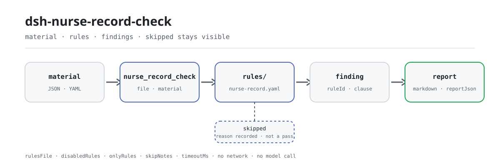

<div align="center">

<picture>
  <source media="(prefers-color-scheme: dark)" srcset="docs/assets/dsh-nurse-record-check-flow-dark.svg">
  
</picture>

# dsh-nurse-record-check

**एक भर्ती प्रकरण के नर्सिंग रिकॉर्ड को पंक्ति-दर-पंक्ति समीक्षा योग्य अंतरों की सूची में बदलें — हर अंतर के साथ उसका उद्धृत खंड।**

नर्सिंग विभागों और हेड नर्सों के लिए स्थानीय जाँच प्लगइन: नर्सिंग प्रविष्टियों, चिकित्सकीय आदेशों और मूल्यांकन प्रपत्रों का संरचित निर्यात पढ़ता है, संस्करणबद्ध नियम-पैक से समय-सीमा, हस्ताक्षर और मूल्यांकन-प्रपत्र की उपलब्धता जाँचता है, और केवल अंतर गिनाता है — अनुपालन का निर्णय कभी नहीं देता।

[इंस्टॉल](#तीन-चरणों-में-शुरुआत) · [कॉन्फ़िगरेशन](#कॉन्फ़िगरेशन) · [FAQ](#faq) · [简体中文](README.md) · [English](README.en.md) · [Español](README.es.md) · [Português](README.pt.md) · [हिन्दी](README.hi.md)

[](LICENSE)
[](#अनुकूलता)
[](https://www.npmjs.com/package/dsh-nurse-record-check)
[](https://github.com/PerryLink/dsh-nurse-record-check/actions/workflows/ci.yml)
[](#अनुकूलता)

[](https://github.com/PerryLink/dsh-nurse-record-check/stargazers)
[](https://www.npmjs.com/package/dsh-nurse-record-check)
[](https://dshfind.com/en/plugins/PerryLink/dsh-nurse-record-check?ref=badge)
[](https://securityscorecards.dev/viewer/?uri=github.com/PerryLink/dsh-nurse-record-check)
[](https://dsh.market/)

```sh
dsh plugin --profile <name> add dsh-nurse-record-check
```

</div>

<sub>समुदाय प्लगइन, DeepSeek से संबद्ध नहीं। एकमात्र रेपो: <https://github.com/PerryLink/dsh-nurse-record-check>।</sub>

## यह क्या है

`dsh-nurse-record-check` एक भर्ती प्रकरण के मशीन-पठनीय निर्यात को पढ़ता है — नर्सिंग प्रविष्टियाँ, चिकित्सकीय आदेश और भरे गए मूल्यांकन प्रपत्र — और उस नर्सिंग दस्तावेज़ की समय-सीमा, हस्ताक्षर और मूल्यांकन-प्रपत्र की उपलब्धता जाँचता है, तथा उद्धृत धाराओं के विरुद्ध शाब्दिक अंतर दर्ज करता है: कि हर नर्सिंग प्रविष्टि में पता लगाने योग्य रिकॉर्डर और समय हो, कि हर दिनांक और समय 24-घंटे के प्रारूप में लिखा हो और पढ़ा जा सके, कि पुनर्जीवन (rescue) रिकॉर्ड का समय मिनट तक सटीक हो और उसका नोट पुनर्जीवन समाप्त होने के 6 घंटे के भीतर लिखा गया हो, कि अस्थायी आदेश में निष्पादन समय और निष्पादन करने वाली नर्स का हस्ताक्षर हो तथा रद्द किए गए आदेश में रद्दीकरण दर्ज हो, कि प्रथम नर्सिंग मूल्यांकन और दस्तावेज़ीकरण की आवृत्ति संस्थान द्वारा कॉन्फ़िगर की गई सीमाओं के अनुरूप हो, कि गिरने के जोखिम और दबाव-घाव के मूल्यांकन प्रपत्र अभिलेख में उपलब्ध हों, और यह कि गश्त का अंतराल रिकॉर्ड में दर्ज देखभाल-स्तर के श्रेणीबद्ध नर्सिंग मार्गदर्शन से मेल खाता हो। जो जाँच चल न सके वह पास होने के बजाय `skipped` में दर्ज की जाती है। नियम-पैक डेटा है, कोड नहीं: `rules/nurse-record.yaml` बदलने से नियम-समुच्चय बदल जाता है, और लोडर ऐसे पैक को अस्वीकार करता है जिसके उद्धरण शब्दशः न हों या जिसकी गंभीरता अपने आधार से बढ़ी हुई हो। जाँच का मुख्य भाग शुद्ध फ़ंक्शन है — कोई नेटवर्क नहीं, कोई मॉडल कॉल नहीं; सामग्री आप देते हैं और मूल दस्तावेज़ कभी नहीं बदला जाता। रोज़ की जाँच के लिए कमांड लाइन की ज़रूरत नहीं: सामग्री सत्र में `nurse_record_check` उपकरण को दें।

## तीन चरणों में शुरुआत

1. **इंस्टॉल करें** (कोई एक चैनल चुनें):

   ```sh
   # git चैनल (नवीनतम main; git+https://github.com/PerryLink/dsh-nurse-record-check.git के बराबर)
   dsh plugin --profile <name> add github:PerryLink/dsh-nurse-record-check
   # npm चैनल (प्रकाशित संस्करण)
   dsh plugin --profile <name> add dsh-nurse-record-check
   # tarball चैनल: इस रेपो में pnpm pack के बाद
   dsh plugin --profile <name> add ./dsh-nurse-record-check-<version>.tgz
   ```

2. **न्यूनतम कॉन्फ़िग** (डिफ़ॉल्ट नियम-पैक और सीमाएँ सीधे काम करती हैं):

   ```yaml
   - insert:
       - id: dsh-nurse-record-check
         name: dsh-nurse-record-check
   ```

   जाँच का दायरा सीमित करना हो तभी `config` जोड़ें; उदाहरण के लिए केवल पहले पाँच नियम चलाना:

   ```yaml
   - insert:
       - id: dsh-nurse-record-check
         name: dsh-nurse-record-check
         config:
           onlyRules: [NR-001, NR-002, NR-003, NR-004, NR-005]
   ```

3. **जाँचें कि माउंट हुआ**:

   ```sh
   dsh --profile <name> --dump-config | grep 'dsh-nurse-record-check'
   ```

   फिर साथ दिए नमूने को बिना नेटवर्क चलाएँ (आउटपुट `samples/quickstart/expected/result.json` से मेल खाना चाहिए):

   ```sh
   pnpm run build
   node samples/quickstart/run.mjs --check
   ```

   ```text
   nurse_record_check: 3 issue(s) — error 1, warn 2, info 0
   skipped: 10
   ```

**अनइंस्टॉल**: `dsh plugin --profile <name> remove dsh-nurse-record-check` (या प्रोफ़ाइल पैच से वह पंक्ति हटाएँ)।

<details>
<summary>WorkBuddy / Coze से इंस्टॉल करना</summary>

WorkBuddy / Coze में Medical Record QC Suite खोजें — यह जाँच उसका एक हिस्सा है; उपलब्धता वही है जो स्टोर में दिखे।

</details>

## मुख्य क्षमताएँ

`dsh-nurse-record-check` एक प्रकरण की नर्सिंग सामग्री को समीक्षा योग्य अंतरों की सूची में बदलता है; हर अंतर के साथ नियम id, गंभीरता, स्थान और उद्धृत खंड होता है:

- **एक पठन, बारह नियम** — नर्सिंग प्रविष्टियाँ, आदेश और मूल्यांकन प्रपत्र एक बार पढ़े जाते हैं; फिर `NR-001` से `NR-012` क्रम से समय-सीमा, हस्ताक्षर और मूल्यांकन-प्रपत्र जाँचते हैं। नियम-सूची नीचे है।
- **नियम-पैक डेटा है** — दस्तावेज़, संख्या, धारा, शब्दशः उद्धरण और स्रोत URL सब `rules/nurse-record.yaml` में हैं; कोड बदले बिना नियम-समुच्चय बदलने के लिए उस फ़ाइल को बदलें।
- **चल न सकना ≠ पास होना** — जो जाँच नहीं चल सकी वह कारण के साथ `skipped` में आती है; खाली परिणाम-सूची को कभी «कुछ गलत नहीं» नहीं पढ़ा जाता।
- **केवल अंतर, कोई निर्णय नहीं** — रिपोर्ट उद्धृत धाराओं के सामने शाब्दिक अंतर बताती है; अनुपालन, ज़िम्मेदारी या नैदानिक निर्णय नहीं देती, और शब्द-संरक्षक ऐसी भाषा रोकता है।
- **स्थानीय, शुद्ध-फ़ंक्शन मुख्य भाग** — `src/check.ts` एक `(input, ruleset, options) => Report` शुद्ध फ़ंक्शन है, जिसमें कोई I/O, घड़ी या मॉडल पहुँच नहीं, इसलिए पूरा नियम-समुच्चय बिना क्रेडेंशियल के परखा जा सकता है।

| नियम | क्या जाँचता है | गंभीरता |
|---|---|---|
| `NR-001` | हर नर्सिंग प्रविष्टि में पता लगाने योग्य रिकॉर्डर (id और समय) हो | error |
| `NR-002` | सामग्री का हर दिनांक/समय 24-घंटे प्रारूप में लिखा और पढ़ने योग्य हो | error |
| `NR-003` | पुनर्जीवन नोट का समय मिनट तक सटीक हो | error |
| `NR-004` | पुनर्जीवन नोट पुनर्जीवन समाप्ति के 6 घंटे के भीतर लिखा गया हो | error |
| `NR-005` | अस्थायी आदेश में निष्पादन समय और निष्पादन करने वाली नर्स का हस्ताक्षर हो | error |
| `NR-006` | निष्पादन समय आदेश के लिखे जाने के समय से पहले न हो | info |
| `NR-007` | रद्द किया गया आदेश अपना रद्दीकरण और हस्ताक्षर दर्ज करे | error |
| `NR-008` | प्रथम नर्सिंग मूल्यांकन **स्थानीय रूप से कॉन्फ़िगर** खिड़की में पूरा हो | info |
| `NR-009` | गिरने के जोखिम और दबाव-घाव के प्रपत्र अभिलेख में हों | warn |
| `NR-010` | रिकॉर्ड की समय-मोहर उस घटना से पहले न हो जिसे वह दर्ज करता है | info |
| `NR-011` | गश्त का अंतराल देखभाल-स्तर के श्रेणीबद्ध नर्सिंग मार्गदर्शन से मेल खाए | error |
| `NR-012` | दस्तावेज़ीकरण की आवृत्ति **स्थानीय रूप से कॉन्फ़िगर** नीति को पूरा करे | info |

`NR-008` और `NR-012` जान-बूझकर खाली सीमाओं के साथ आते हैं, क्योंकि नियम-पैक को नर्सिंग रिकॉर्ड पर लागू होने वाली कोई राष्ट्रीय सीमा नहीं मिली; वे स्वयं को `skipped` में दर्ज करते हैं और कभी चुपचाप पास नहीं होते।

## उदाहरण

नीचे दिया समुच्चय उदाहरण-समुच्चय है: पहला खंड विस्तृत केस है और तालिका सामान्य प्रश्नों को कवर करती है। उदाहरण प्लगइन के अपने परीक्षण फ़िक्स्चर से हैं — काल्पनिक चित्र नहीं।

**विस्तृत आउटपुट** — उपकरण `nurse_record_check`, इनपुट:

```yaml
records:
  - id: REC-0001
    kind: general
    recordedAt: "2026-03-15 09:00"
    nurseId: N10231
  - id: REC-0002
    kind: general
    recordedAt: "2026-03-15 11:00"
    nurseName: 李护士
```

आउटपुट:

```json
{
  "id": "dsh-nurse-record-check.NR-001.185cc700",
  "ruleId": "NR-001",
  "severity": "error",
  "locator": {
    "cell": "REC-0002"
  },
  "found": "记录无签名护士标识",
  "expected": "每条护理记录均应有签名"
}
```

*स्रोत `dsh-nurse-record-check/tests/fixtures/NR-001/NR-001-unsafe.yaml`*

| आपका सवाल | इसका जवाब |
|---|---|
| एक नर्सिंग प्रविष्टि में हस्ताक्षर करने वाली नर्स का विवरण नहीं है। क्या यह दर्ज होता है? | हाँ। `NR-001` ऐसी हर नर्सिंग प्रविष्टि दर्ज करता है जिसमें रिकॉर्डर का कोई पहचान-चिह्न न हो, और ऐसा `nurseId` भी जो कॉन्फ़िगर किए गए कर्मचारी-क्रमांक प्रारूप से मेल न खाए। यह देखता है कि सामग्री में रिकॉर्डर का चिह्न और समय छूटा है या नहीं — इलेक्ट्रॉनिक हस्ताक्षर तकनीकी रूप से कैसे लागू किया गया है, यह नहीं जाँचता। |
| निर्यात में एक समय-मान पढ़ा नहीं जा सकता। नियम उसके साथ क्या करता है? | `NR-002` उस मान को दर्ज करता है और अपेक्षा करता है कि समय 24-घंटे के प्रारूप में लिखा हो तथा `YYYY-MM-DD HH:mm` के रूप में पढ़ा जा सके। जिस प्रविष्टि का समय पढ़ा न जा सके वह आगे की समय-सीमा तुलनाओं में शामिल नहीं होती, इसलिए वह यहीं दिखती है, समय-सीमा के अंतर के रूप में नहीं — यह नियम देखता है कि समय पढ़ा जा सकता है या नहीं, यह नहीं कि वह सच्चा है। |
| हमारे पुनर्जीवन रिकॉर्ड में तारीख है, पर घड़ी का कोई समय नहीं। | `NR-003` ऐसे `rescue` रिकॉर्ड को दर्ज करता है जिसका समय केवल दिन तक सटीक है, क्योंकि पुनर्जीवन का समय मिनट तक सटीक होना चाहिए। नियम-पैक बताता है कि उसके उद्धृत दोनों दस्तावेज़ एक ही बात नहीं माँगते — एक पुनर्जीवन-समय को मिनट तक और दूसरा रिकॉर्ड-समय को — इसलिए दोनों को साथ प्रस्तुत किया गया है और हर स्रोत अलग से चिह्नित है। |
| पुनर्जीवन का नोट अगली सुबह लिखा गया। क्या यह देर है? | `NR-004` दर्ज समय की तुलना `rescueEndedAt` से करता है और 6 घंटे से अधिक का अंतराल दर्ज करता है; पुनर्जीवन समाप्त होने से पहले लिखा गया नोट भी दर्ज होता है। `rescueEndedAt` न हो तो तुलना करने को कुछ नहीं बचता, और जाँच पास होने के बजाय बताती है कि वह चल नहीं सकी। |
| एक अस्थायी आदेश निष्पादित हुआ, पर निष्पादन करने वाली नर्स के हस्ताक्षर का खाना खाली है। | `NR-005` ऐसे अस्थायी आदेश को दर्ज करता है जिसके निष्पादन रिकॉर्ड में निष्पादन समय या निष्पादन करने वाली नर्स का हस्ताक्षर नहीं है। यह केवल अस्थायी आदेशों पर लागू होता है — दीर्घकालिक आदेश-पत्र के मद अलग होते हैं और दोनों को एक-सा नहीं पढ़ा जा सकता — और यह नहीं जाँचता कि निष्पादन के कितनी देर बाद हस्ताक्षर हुआ, क्योंकि नियम-पैक को हस्ताक्षर की कोई समय-सीमा नहीं मिली। |
| कुछ नियम पास होने के बजाय `skipped` दिखाते हैं। इसका क्या मतलब है? | इसका मतलब है कि जाँच चली ही नहीं, यह नहीं कि वह पास हो गई। `NR-008` और `NR-012` की सीमाएँ (`maxAfterAdmission`, `intervalHours`) खाली आती हैं, क्योंकि नियम-पैक को नर्सिंग रिकॉर्ड पर लागू होने वाली कोई राष्ट्रीय सीमा नहीं मिली — और वह यह भी दर्ज करता है कि उसे जो 24 घंटे मिले वे चिकित्सक द्वारा लिखे जाने वाले प्रवेश-रिकॉर्ड के हैं और प्रथम नर्सिंग मूल्यांकन पर लागू नहीं किए जा सकते — `NR-011` भी विशेष स्तर की देखभाल में `skipped` दर्ज करता है, जहाँ मार्गदर्शन कोई अंतराल नहीं देता, और जब तुलना के लिए दो से कम `rounds` प्रविष्टियाँ हों। |

## कॉन्फ़िगरेशन

सभी समायोज्य पैरामीटर `src/config.ts` की Schemastery स्कीमा में हैं, इसलिए कोड बदले बिना `cordis.yml` से बदले जा सकते हैं।

| कुंजी | प्रकार | डिफ़ॉल्ट | विवरण |
|---|---|---|---|
| `rulesFile` | string | `rules/nurse-record.yaml` | नियम-पैक का पथ, पैकेज रूट के सापेक्ष |
| `disabledRules` | string[] | `[]` | बंद करने वाले नियम id; प्रत्येक `skipped` में दिखता है |
| `onlyRules` | string[] | `[]` | केवल ये नियम चलाएँ; खाली होने पर सभी नियम चलते हैं |
| `skipNotes` | string | `""` | हर `skipped` कारण के आगे जोड़ी जाने वाली टिप्पणी |
| `timeoutMs` | number | `120000` | उपकरण का सहकारी समय-सीमा बजट |

<details>
<summary>सीमाएँ Config में नहीं, नियम-पैक में रहती हैं</summary>

`Config` में ऊपर दी गई ठीक पाँच कुंजियाँ हैं। प्रति-नियम सीमाएँ `rules/nurse-record.yaml` के `params` में रहती हैं, उदाहरण के लिए `NR-008` के लिए `maxAfterAdmission`, `NR-012` के लिए `intervalHours` और `NR-004` के लिए `maxHours`; नियम-पैक बदलते या संपादित करते समय उन्हें भी समायोजित करें।

</details>

प्रोफ़ाइल पैच में ओवरराइड का उदाहरण:

```yaml
- insert:
    - id: dsh-nurse-record-check
      name: dsh-nurse-record-check
      config:
        disabledRules: [NR-011]
        skipNotes: संस्थान ने अभी गश्त-जाँच को नहीं अपनाया
        timeoutMs: 60000
```

## सामग्री प्रारूप

JSON और YAML स्वीकार्य हैं। **docx या xlsx बाइनरी नहीं पढ़ी जाती**: वार्ड प्रणालियाँ JSON पेलोड या सपाट तालिका निर्यात करती हैं, और नीचे दिया अनुबंध वह है जिसे कॉलर (या आपका अपना कनवर्टर) भरता है। Excel को पहले JSON/YAML में बदला जा सकता है — चैट में भी, जहाँ प्लेटफ़ॉर्म यह सुविधा दे। पढ़ने की परत में फ़ील्ड वैकल्पिक हैं और जाँच इंजन उन्हें सत्यापित करता है, इसलिए आंशिक निर्यात पर क्रैश के बजाय "अनुपस्थित" श्रेणी के निष्कर्ष मिलते हैं।

```yaml
target: 内科三病区 2026-03-15 护理记录
episode:
  admittedAt: "2026-03-15 08:00"   # NR-008 को चलाता है
  careLevel: level-2               # NR-011 / NR-012 को चलाता है
  patientLabel: 样本患者甲
records:
  - id: REC-0001
    kind: rescue                   # rescue | general | rounds | handover | discharge | other
    recordedAt: "2026-03-15 14:20"
    rescueEndedAt: "2026-03-15 13:50"
    nurseId: N10231
    orderId: ORD-1001              # रिकॉर्ड को आदेश से जोड़ता है, NR-010 के लिए
orders:
  - id: ORD-1001
    type: temporary                # temporary | long-term
    orderedAt: "2026-03-15 10:00"
    execution: { executedAt: "2026-03-15 10:20", nurseId: N10231, outcome: executed }
    cancellation: { cancelledAt: "2026-03-15 10:10", reason: 患者外出检查 }
assessments:
  - kind: 跌倒坠床风险评估          # साझा समानार्थी मानचित्र से मिलाया जाता है
    completedAt: "2026-03-15 09:40"
```

## यह किन मानकों पर आधारित है

| दस्तावेज़ | संख्यांक | इन्हें उद्धृत करने वाले नियम |
|---|---|---|
| 《电子病历应用管理规范（试行）》 | 国卫办医发〔2017〕8号 | NR-001, NR-006, NR-010 |
| 《病历书写基本规范》 | 卫医政发〔2010〕11号 | NR-002, NR-003, NR-004, NR-005, NR-007, NR-010, NR-012 |
| 《医疗质量安全核心制度要点》 | 国卫医发〔2018〕8号 | NR-003, NR-004 |
| 《卫生部办公厅关于在医疗机构推行表格式护理文书的通知》 | 卫办医政发〔2010〕125号 | NR-005 |
| 《护理分级标准》 | WS/T 431—2023（全部代替 WS/T 431—2013；推荐性卫生行业标准，2024-02-01 施行） | NR-008 |
| 《进一步改善护理服务行动计划（2023—2025年）》 | 国卫医政发〔2023〕16号 | NR-009 |
| 《三级医院评审标准（2020年版）》 | 国卫医发〔2020〕26号 | NR-009 |
| 《综合医院分级护理指导原则（试行）》 | 卫医政发〔2009〕49号 | NR-011 |

**सीमा:** यह प्लगइन एक **भर्ती** प्रकरण में **नर्सिंग** दस्तावेज़ (नर्सिंग रिकॉर्ड) की समय-सीमा, हस्ताक्षर और मूल्यांकन-प्रपत्र की उपलब्धता जाँचता है। यह `dsh-medrec-qc` नहीं है (जो मेडिकल रिकॉर्ड की मुख्य शीट और उसके आंतरिक विरोधाभासों को जाँचता है), नर्सिंग-गुणवत्ता स्कोरकार्ड नहीं है, और नैदानिक निर्णय सहायक नहीं है। यह मशीन-पठनीय निर्यात पढ़ता है और उद्धृत धाराओं के विरुद्ध शाब्दिक अंतर दर्ज करता है; यह कभी नहीं तय करता कि देखभाल का कोई प्रकरण उपयुक्त था या नहीं।

## नियमों के स्रोत

नियम-डेटा कोड से अलग है: प्रत्येक नियम में दस्तावेज़, संख्या, स्रोत की अपनी क्रमांकन-प्रणाली के अनुसार धारा, शब्दशः उद्धरण और स्रोत URL होता है। लोडर तीन बातें लागू करता है: उद्धरण वास्तविक उद्धरण हो, आठ अक्षरों से छोटा उद्धरण अस्वीकार हो, और जिस जाँच का आधार केवल सामान्य सिद्धांत (`kind: derived-from-principle`, अधिकतम `warn`) या स्थानीय नीति (`kind: institutional-configuration`, अधिकतम `info`) हो, उसे कभी `error` घोषित न किया जाए। अपने आधार को बढ़ाकर बताने वाला पैक लोड ही नहीं होता, बजाय इसके कि एक भरोसेमंद दिखने वाली रिपोर्ट बनाए।

धारा-संख्या ऊपर सूचीबद्ध आठ दस्तावेज़ों के पूर्ण पाठों से जाँची गई। प्रति-धारा सत्यापन अभिलेख `rules/evidence/` में हैं, सूची [`rules/evidence/clause-verification.md`](rules/evidence/clause-verification.md) में।

उस सत्यापन के तीन निष्कर्षों ने इस नियम-पैक को आकार दिया, और यहाँ दर्ज हैं ताकि समीक्षक देख सके कि क्या जान-बूझकर **नहीं** कहा गया:

1. **दस्तावेज़ीकरण-आवृत्ति का कोई राष्ट्रीय नियम नहीं है।** WS/T 431—2023 ने अपने 2013 संस्करण का «कार्यान्वयन आवश्यकताएँ» अध्याय हटा दिया, और श्रेणीबद्ध नर्सिंग मार्गदर्शन *गश्त* का अंतराल बताता है, *दस्तावेज़ीकरण* की आवृत्ति कभी नहीं। इसलिए `NR-012` खाली सीमा के साथ आता है।
2. **प्रथम नर्सिंग मूल्यांकन के लिए कोई राष्ट्रीय समय-सीमा नहीं है।** बुनियादी मानकों के अनुच्छेद 17 का 24-घंटे नियम चिकित्सक के प्रवेश-नोट पर लागू होता है, नर्सिंग मूल्यांकन पर नहीं; उसे यहाँ लागू करना गलत उद्धरण होगा। इसलिए `NR-008` खाली सीमा के साथ आता है।
3. **कोई धारा यह नहीं रोकती कि रिकॉर्ड का समय निष्पादन के समय से पहले हो।** `NR-010` अनुच्छेद 3 के सामान्य कर्तव्य पर आधारित है और इसीलिए `info` तक सीमित है।

## FAQ

<details>
<summary>क्या सामग्री अपलोड या संग्रहित होती है?</summary>

नहीं। यह स्थानीय जाँचकर्ता है: केवल वही सामग्री पढ़ता है जो आप उपकरण को देते हैं, कोई नेटवर्क अनुरोध या मॉडल कॉल नहीं करता, और कोई टेलीमेट्री या पृष्ठभूमि रिपोर्टिंग नहीं भेजता। उपकरण के परिणाम और DSH होस्ट के अपने सत्र/लॉग भंडारण के बाहर यह कोई डेटा नहीं लिखता। वह भंडारण और उसकी अवधि होस्ट नियंत्रित करता है; यह पैकेज दूसरी प्रति नहीं जोड़ता। पैकेज हटाने से उसका कोड हटता है; होस्ट के सत्र लॉग या आपके बनाए दस्तावेज़ नहीं हटते।

</details>

<details>
<summary>क्या खाली परिणाम-सूची का मतलब है कि नर्सिंग रिकॉर्ड अनुपालन में है?</summary>

नहीं। खाली परिणाम-सूची को कभी «कुछ गलत नहीं» नहीं पढ़ा जा सकता: जो जाँच नहीं चल सकी वह कारण के साथ `skipped` में आती है, रिपोर्ट हमेशा अस्वीकरण के साथ आती है, और शब्द-संरक्षक अनुपालन, ज़िम्मेदारी व सत्यता के निर्णय रोकता है। यह केवल सामग्री और उद्धृत धाराओं के बीच शाब्दिक अंतर गिनाता है; मानव समीक्षक तय करता है कि आगे क्या करना है।

</details>

<details>
<summary>कुछ नियम हमेशा skipped क्यों दिखते हैं?</summary>

क्योंकि उनकी कोई चलाने योग्य राष्ट्रीय सीमा नहीं है, और जाँचकर्ता उन्हें चुपचाप पास करने से इनकार करता है। `NR-008` (`maxAfterAdmission`) और `NR-012` (`intervalHours`) खाली आते हैं और संस्थान को कॉन्फ़िगर करने होते हैं; `NR-011` विशेष स्तर की देखभाल में `skipped` दर्ज करता है (मार्गदर्शन उस स्तर के लिए अंतराल नहीं देता) और जब दो से कम तुलनीय `rounds` प्रविष्टियाँ हों।

</details>

<details>
<summary>क्या यह अन्य DSH प्लगइन से टकराता है?</summary>

प्लगइन ठीक एक उपकरण, `nurse_record_check`, पंजीकृत करता है और `inject: ['tools']` के माध्यम से tools सेवा पर निर्भर है। यह कोई सेवा-कुंजी नहीं देता, कोई क्लाइंट स्लॉट या `webServer` मार्ग पंजीकृत नहीं करता, और कोई ग्लोबल नहीं बदलता। उपकरण का पंजीकरण Cordis effect है, इसलिए अनलोड या हॉट रीलोड उसे हटा देता है। यह कोई नेटवर्क अनुरोध नहीं करता और अन्य प्लगइन से डेटा नहीं बदलता।

</details>

<details>
<summary>प्रदर्शन पर कितना खर्च है?</summary>

मुख्य भाग शुद्ध फ़ंक्शन है: JSON/YAML पढ़ना, 12 नियम चलाना और रिपोर्ट बनाना — कोई नेटवर्क, कोई मॉडल कॉल, कोई डेटाबेस लेखन नहीं। `timeoutMs` का डिफ़ॉल्ट 120000 ms है और वह केवल सहकारी समय-सीमा बजट है। वास्तविक समय सामग्री के आकार और नियम-संख्या पर निर्भर है; पूरे फ़ोल्डर के लिए `ptc` टूल मोड चुनें ताकि schema लागत एक ही बार देनी पड़े।

</details>

## सुरक्षा सीमाएँ और डेटा

- **केवल-पठन सामग्री।** जाँचकर्ता वह फ़ाइल या इनलाइन टेक्स्ट पढ़ता है जो आप उपकरण को देते हैं; मूल दस्तावेज़ नहीं बदलता और सामग्री फ़ोल्डर में कोई फ़ाइल नहीं लिखता।
- **कोई निर्णायक फैसला नहीं।** रिपोर्ट कभी नहीं कहती कि कोई प्रकरण अनुपालन में, अनुपालन से बाहर या उपयुक्त है; `src/shared/wording.ts` का शब्द-संरक्षक ऐसी भाषा रोकता है और रिपोर्ट हमेशा अस्वीकरण के साथ आती है।
- **लोड के समय नियम-पैक सत्यापन।** उद्धरण कम से कम आठ अक्षरों का शब्दशः उद्धरण होना चाहिए; `derived-from-principle` की सीमा `warn` और `institutional-configuration` की `info` है; अपने आधार को बढ़ाकर बताने वाला पैक लोड ही नहीं होता, बजाय इसके कि भरोसेमंद दिखने वाली रिपोर्ट बनाए।
- **स्थानीय संचालन।** कोई नेटवर्क अनुरोध, कोई मॉडल कॉल, कोई टेलीमेट्री, कोई क्रेडेंशियल पठन नहीं; उपकरण के परिणाम और होस्ट के सत्र/लॉग भंडारण के बाहर कुछ नहीं लिखा जाता (देखें `PRIVACY.md`)।
- **पंजीकरण एक effect है।** उपकरण का पंजीकरण `ctx.tools.register` से लौटाए disposer द्वारा हटता है, इसलिए प्लगइन रोकने या हॉट रीलोड करने पर कोई लटकता उपकरण नहीं बचता।

## ज्ञात सीमाएँ

- **केवल JSON / YAML।** docx और xlsx बाइनरी नहीं पढ़ी जाती; पहले वार्ड निर्यात को ऊपर दिए सामग्री-अनुबंध में बदलें; कनवर्टर आपकी ज़िम्मेदारी है।
- **वॉल-क्लॉक गणित।** सारी समय-गणना दिए गए स्ट्रिंग को स्थानीय समय मानकर तुलना करती है, कोई समय-क्षेत्र रूपांतरण नहीं; रिकॉर्ड का अर्थ वही स्थानीय समय है जो लिखा गया था।
- **दो नियम बिना कॉन्फ़िगर आते हैं।** `NR-008` और `NR-012` अपनी सीमाएँ कॉन्फ़िगर होने तक `skipped` रहते हैं; `NR-011` भी विशेष स्तर की देखभाल में या दो से कम तुलनीय `rounds` प्रविष्टियों के साथ `skipped` रहता है।
- **अनुपलब्ध उद्धरण अंतराल के रूप में दर्ज होता है।** जब किसी उद्धरण का शब्दशः पाठ नहीं मिला, तो निष्कर्ष `warn` / `info` पर रुकता है और अपने `excerpt` में यह बताता है; यह सत्यापन का अंतराल है, सामग्री के अनुपालन का प्रमाण नहीं।
- **समीक्षा का विकल्प नहीं।** रिपोर्ट केवल अंतर गिनाती है; यह तय नहीं करती कि देखभाल का कोई प्रकरण उपयुक्त था या नहीं, और ज़िम्मेदारी नहीं ठहराती। आगे क्या करना है, यह समीक्षक तय करता है।

## अनुकूलता

| सतह | स्थिति |
|---|---|
| Harness | peer रेंज `>=0.1.2-rc.1 <0.2.0 \|\| >=0.2.0-0 <0.3.0` — `0.2.0-rc.2` और `0.2.1-rc.2` दोनों को स्वीकार करने के लिए सत्यापित। `engines.dsh` `>=0.2.1-0 <0.3.0` के रूप में घोषित है और 0.2.1 से होस्ट इसे लागू करता है |
| Node | `^22.19.0 || >=24.0.0` |
| प्लेटफ़ॉर्म | सभी (शुद्ध ESM; कोई नेटिव कोड नहीं, कोई नेटवर्क नहीं, कोई मॉडल कॉल नहीं) |
| टूल मोड | `native` और `ptc` में काम करता है; पूरे फ़ोल्डर के लिए `ptc` चुनें ताकि schema लागत एक ही बार देनी पड़े |

## पारिस्थितिकी और गुणवत्ता

- [dshfind प्लगइन पृष्ठ](https://dshfind.com/en/plugins/PerryLink/dsh-nurse-record-check?ref=badge) (इंस्टॉल और रैंकिंग)
- [OpenSSF Scorecard रिपोर्ट](https://securityscorecards.dev/viewer/?uri=github.com/PerryLink/dsh-nurse-record-check) ([.github/workflows/scorecard.yml](.github/workflows/scorecard.yml) द्वारा संचालित)
- [DSH Market](https://dsh.market/) (सूचीबद्ध)
- [npm पैकेज पृष्ठ](https://www.npmjs.com/package/dsh-nurse-record-check) (प्रकाशित संस्करण और डाउनलोड)
- [PerryLink प्लगइन परिवार](https://github.com/PerryLink) और [सामग्री के अनुसार जाँचकर्ता चुनें](https://perrylink.github.io/zh/checkers/choose/) (62 जाँचकर्ता + सामान्य प्लगइन)

## समस्या निवारण

- **प्लगइन इंस्टॉल हो गया पर टूल दिखता नहीं।** जाँचें कि `main` `lib/index.mjs` पर जाता है और `pnpm run build` ने उसे बनाया है; गलत `main` से लोडर उस प्रविष्टि को चुपचाप छोड़ देता है।
- **`dsh plugin add` असंगत बताकर मना करता है।** peer रेंज `0.1.x` और `0.2.x` दोनों को कवर करती है; यदि आपका रनटाइम उससे बाहर है तो स्पष्ट छूट दें: `dsh plugin --profile <name> allow-version <package@version> --dsh-version <runtime> --accept-risk`।
- **कोई अपेक्षित नियम नहीं चला।** `skipped` सरणी देखें, वह नियम और कारण बताती है। `NR-008` और `NR-012` अपनी सीमाएँ कॉन्फ़िगर होने तक `skipped` रहते हैं।
- **`check` में `manifest-peers` विफल दिखता है।** स्थिर जाँचकर्ता 0.2 लाइन से पहले की हार्डकोडेड peer रेंज से तुलना करता है; रनटाइम इंस्टॉल के समय अनुकूलता लागू करता है। यह `dsh-plugin-dev` की ज्ञात अपस्ट्रीम समस्या है।
- **समय खिसका हुआ लगता है।** सारी गणना दिए गए स्ट्रिंग पर वॉल-क्लॉक है, कोई समय-क्षेत्र रूपांतरण नहीं।
- **रिपोर्ट में कोई समस्या नहीं दिखती।** पहले `skippedCount` देखें; खाली सूची अनुपालन नहीं है — FAQ देखें।

## विकास

```sh
pnpm install
pnpm run typecheck                # tsc --noEmit
pnpm test                         # vitest, प्रति नियम अनुरूप/उल्लंघन फ़िक्स्चर जोड़े में
pnpm run build                    # tsdown -> lib/index.mjs + lib/index.d.mts
pnpm run verify:self-contained    # निर्भरता specs registry से हल होती हैं
pnpm run check:lockfile           # lockfile ड्रिफ्ट जाँच
pnpm run check:readmes            # पाँच-भाषा README एकरूपता
pnpm run check:citations          # नियम-पैक उद्धरण सत्यापन
pnpm pack                         # प्रकाशित tarball
```

साझा किट ताज़ा करना हो तो: `node ../scripts/sync-shared.mjs dsh-nurse-record-check`, जो `../_shared` को `src/shared/` में कॉपी करता है; हर साझा बदलाव के बाद इसे दोबारा चलाएँ।

| पथ | सामग्री |
|---|---|
| `src/index.ts` | फ़ंक्शन-प्लगइन प्रवेश: `name`/`inject`/`Config`/`apply`, `nurse_record_check` उपकरण पंजीकृत करता है |
| `src/check.ts` | शुद्ध जाँच मुख्य भाग, `(input, ruleset, options) => Report` |
| `src/config.ts` | Schemastery स्कीमा; सभी समायोज्य पैरामीटर यहीं |
| `src/parse.ts` / `src/view.ts` | JSON/YAML पाठक और मॉडल के लिए रिपोर्ट प्रक्षेपण |
| `rules/nurse-record.yaml` | नियम-पैक (12 नियम) |
| `rules/evidence/` | हर उद्धरण का सत्यापन अभिलेख |
| `tests/fixtures/<RULE>/` | प्रति नियम अनुरूप/उल्लंघन फ़िक्स्चर जोड़े |
| `samples/quickstart/` | एक मिनट का ऑफ़लाइन नमूना |

README की छवियाँ [`scripts/gen-readme-assets.py`](scripts/gen-readme-assets.py) से क्रमादेशित रूप से बनती हैं (Python + Pillow; हल्का और गहरा SVG) और बिना जोखिम दोबारा चलाई जा सकती हैं। स्क्रिप्ट CJK फ़ॉन्ट खोजती है और खाली डिब्बे बनाने के बजाय त्रुटि के साथ रुक जाती है।

Topics: `deepseek-harness`, `dsh`, `dsh-plugin`, `cordis`, `nurse`, `record`

## परिवार और आभार

यह परियोजना [PerryLink](https://github.com/PerryLink) द्वारा अनुरक्षित DeepSeek Harness प्लगइन परिवार का सदस्य है (सभी Apache-2.0)। अगर यह उपयोगी हो, **एक स्टार अगले व्यक्ति को इसे खोजने में मदद करता है** — इसके पीछे कोई सुविधा बंद नहीं है।

- [@PerryLink](https://github.com/PerryLink) — निर्माता और अनुरक्षक: नियम-पैक, जाँच मुख्य भाग, सामग्री पाठक और पाँच-भाषा दस्तावेज़।

<details>
<summary>सभी प्लगइन फैलाएँ</summary>

| प्लगइन | स्थिति |
|---|---|
| **[dsh-aqua-input-check](https://github.com/PerryLink/dsh-aqua-input-check)** |  |
| **[dsh-archive-check](https://github.com/PerryLink/dsh-archive-check)** |  |
| **[dsh-auto-review](https://github.com/PerryLink/dsh-auto-review)** |  |
| **[dsh-autotier](https://github.com/PerryLink/dsh-autotier)** | 🧊 फ़्रोज़न — रेपो README देखें |
| **[dsh-bid-ca-precheck](https://github.com/PerryLink/dsh-bid-ca-precheck)** |  |
| **[dsh-bid-qual-check](https://github.com/PerryLink/dsh-bid-qual-check)** |  |
| **[dsh-cert-mcp](https://github.com/PerryLink/dsh-cert-mcp)** | 🧊 फ़्रोज़न — रेपो README देखें |
| **[dsh-checkpoint-rewind](https://github.com/PerryLink/dsh-checkpoint-rewind)** |  |
| **[dsh-click](https://github.com/PerryLink/dsh-click)** |  |
| **[dsh-composer-history](https://github.com/PerryLink/dsh-composer-history)** |  |
| **[dsh-contract-stance](https://github.com/PerryLink/dsh-contract-stance)** |  |
| **[dsh-customs-doc-check](https://github.com/PerryLink/dsh-customs-doc-check)** |  |
| **[dsh-data-quality](https://github.com/PerryLink/dsh-data-quality)** | 🧊 फ़्रोज़न — रेपो README देखें |
| **[dsh-demurrage-ledger](https://github.com/PerryLink/dsh-demurrage-ledger)** |  |
| **[dsh-doublecheck](https://github.com/PerryLink/dsh-doublecheck)** |  |
| **[dsh-drill-script-check](https://github.com/PerryLink/dsh-drill-script-check)** |  |
| **[dsh-eia-guide-check](https://github.com/PerryLink/dsh-eia-guide-check)** |  |
| **[dsh-emergency-plan](https://github.com/PerryLink/dsh-emergency-plan)** |  |
| **[dsh-essay-rubric-check](https://github.com/PerryLink/dsh-essay-rubric-check)** |  |
| **[dsh-evidence-check](https://github.com/PerryLink/dsh-evidence-check)** |  |
| **[dsh-export-ctl-check](https://github.com/PerryLink/dsh-export-ctl-check)** |  |
| **[dsh-fast](https://github.com/PerryLink/dsh-fast)** |  |
| **[dsh-fmea-table-check](https://github.com/PerryLink/dsh-fmea-table-check)** |  |
| **[dsh-forecast-penalty](https://github.com/PerryLink/dsh-forecast-penalty)** |  |
| **[dsh-fund-research](https://github.com/PerryLink/dsh-fund-research)** |  |
| **[dsh-github](https://github.com/PerryLink/dsh-github)** |  |
| **[dsh-gongwen-flow-check](https://github.com/PerryLink/dsh-gongwen-flow-check)** |  |
| **[dsh-gongwen-word-check](https://github.com/PerryLink/dsh-gongwen-word-check)** |  |
| **[dsh-guard-plan-qc](https://github.com/PerryLink/dsh-guard-plan-qc)** |  |
| **[dsh-hazchem-check](https://github.com/PerryLink/dsh-hazchem-check)** |  |
| **[dsh-hazplan-check](https://github.com/PerryLink/dsh-hazplan-check)** |  |
| **[dsh-hidden-risk-map](https://github.com/PerryLink/dsh-hidden-risk-map)** |  |
| **[dsh-hs-classify](https://github.com/PerryLink/dsh-hs-classify)** |  |
| **[dsh-icd-rule-check](https://github.com/PerryLink/dsh-icd-rule-check)** |  |
| **[dsh-industry-research](https://github.com/PerryLink/dsh-industry-research)** |  |
| **[dsh-lawcite-adapter](https://github.com/PerryLink/dsh-lawcite-adapter)** |  |
| **[dsh-laya](https://github.com/PerryLink/dsh-laya)** |  |
| **[dsh-lc-doc-check](https://github.com/PerryLink/dsh-lc-doc-check)** |  |
| **[dsh-learning-gap-check](https://github.com/PerryLink/dsh-learning-gap-check)** |  |
| **[dsh-library](https://github.com/PerryLink/dsh-library)** |  |
| **[dsh-local-ai](https://github.com/PerryLink/dsh-local-ai)** |  |
| **[dsh-lsp-actions](https://github.com/PerryLink/dsh-lsp-actions)** |  |
| **[dsh-mask](https://github.com/PerryLink/dsh-mask)** |  |
| **[dsh-mcp-panel](https://github.com/PerryLink/dsh-mcp-panel)** |  |
| **[dsh-medrec-qc](https://github.com/PerryLink/dsh-medrec-qc)** |  |
| **[dsh-memento](https://github.com/PerryLink/dsh-memento)** | 🧊 फ़्रोज़न — रेपो README देखें |
| **[dsh-nsfc-form-check](https://github.com/PerryLink/dsh-nsfc-form-check)** |  |
| **[dsh-nurse-record-check](https://github.com/PerryLink/dsh-nurse-record-check)** |  |
| **[dsh-observe](https://github.com/PerryLink/dsh-observe)** |  |
| **[dsh-origin-rvc-check](https://github.com/PerryLink/dsh-origin-rvc-check)** |  |
| **[dsh-ota-review-check](https://github.com/PerryLink/dsh-ota-review-check)** |  |
| **[dsh-output-styles](https://github.com/PerryLink/dsh-output-styles)** |  |
| **[dsh-paper-doc-adapter](https://github.com/PerryLink/dsh-paper-doc-adapter)** |  |
| **[dsh-permission-rules](https://github.com/PerryLink/dsh-permission-rules)** |  |
| **[dsh-permit-report-check](https://github.com/PerryLink/dsh-permit-report-check)** |  |
| **[dsh-pipeline-check](https://github.com/PerryLink/dsh-pipeline-check)** |  |
| **[dsh-pleading-draft](https://github.com/PerryLink/dsh-pleading-draft)** |  |
| **[dsh-plugin-doctor](https://github.com/PerryLink/dsh-plugin-doctor)** | 🚫 रिटायर्ड (रेपो संग्रहीत) |
| **[dsh-plugin-guide](https://github.com/PerryLink/dsh-plugin-guide)** |  |
| **[dsh-plugin-kit](https://github.com/PerryLink/dsh-plugin-kit)** | 🚫 रिटायर्ड (रेपो संग्रहीत) |
| **[dsh-plugin-upgrade](https://github.com/PerryLink/dsh-plugin-upgrade)** | 🚫 रिटायर्ड (रेपो संग्रहीत) |
| **[dsh-policy-brief-draft](https://github.com/PerryLink/dsh-policy-brief-draft)** |  |
| **[dsh-power-loss-split](https://github.com/PerryLink/dsh-power-loss-split)** |  |
| **[dsh-power-ticket-check](https://github.com/PerryLink/dsh-power-ticket-check)** |  |
| **[dsh-ppap-check](https://github.com/PerryLink/dsh-ppap-check)** |  |
| **[dsh-protest-deadline](https://github.com/PerryLink/dsh-protest-deadline)** |  |
| **[dsh-railway-window](https://github.com/PerryLink/dsh-railway-window)** |  |
| **[dsh-repair-order-qc](https://github.com/PerryLink/dsh-repair-order-qc)** |  |
| **[dsh-research-report](https://github.com/PerryLink/dsh-research-report)** |  |
| **[dsh-review-reply-check](https://github.com/PerryLink/dsh-review-reply-check)** |  |
| **[dsh-rulefile-check](https://github.com/PerryLink/dsh-rulefile-check)** |  |
| **[dsh-safety-brief-check](https://github.com/PerryLink/dsh-safety-brief-check)** |  |
| **[dsh-score](https://github.com/PerryLink/dsh-score)** | 🧊 फ़्रोज़न — रेपो README देखें |
| **[dsh-session-sync](https://github.com/PerryLink/dsh-session-sync)** |  |
| **[dsh-site-log-check](https://github.com/PerryLink/dsh-site-log-check)** |  |
| **[dsh-skill-pack-security](https://github.com/PerryLink/dsh-skill-pack-security)** |  |
| **[dsh-soe-decision-check](https://github.com/PerryLink/dsh-soe-decision-check)** |  |
| **[dsh-soilwater-check](https://github.com/PerryLink/dsh-soilwater-check)** |  |
| **[dsh-sop-sync-check](https://github.com/PerryLink/dsh-sop-sync-check)** |  |
| **[dsh-spc-gbt-adapter](https://github.com/PerryLink/dsh-spc-gbt-adapter)** |  |
| **[dsh-talk](https://github.com/PerryLink/dsh-talk)** |  |
| **[dsh-tender-extract](https://github.com/PerryLink/dsh-tender-extract)** |  |
| **[dsh-tender-matrix](https://github.com/PerryLink/dsh-tender-matrix)** |  |
| **[dsh-test-drive](https://github.com/PerryLink/dsh-test-drive)** |  |
| **[dsh-ticktick](https://github.com/PerryLink/dsh-ticktick)** | 🚫 रिटायर्ड (रेपो संग्रहीत) |
| **[dsh-translate](https://github.com/PerryLink/dsh-translate)** |  |
| **[dsh-warranty-calc](https://github.com/PerryLink/dsh-warranty-calc)** |  |
| **[dsh-budget](https://github.com/PerryLink/dsh-budget)** | 🧊 फ़्रोज़न — रेपो README देखें |
| **[dsh-claude-move](https://github.com/PerryLink/dsh-claude-move)** | 🧊 फ़्रोज़न — रेपो README देखें |
| **[dsh-defend](https://github.com/PerryLink/dsh-defend)** | 🧊 फ़्रोज़न — रेपो README देखें |
| **[dsh-draw](https://github.com/PerryLink/dsh-draw)** | 🧊 फ़्रोज़न — रेपो README देखें |
| **[dsh-reach](https://github.com/PerryLink/dsh-reach)** | 🧊 फ़्रोज़न — रेपो README देखें |
| **[dsh-background-agents](https://github.com/PerryLink/dsh-background-agents)** | 🚫 रिटायर्ड (रेपो संग्रहीत) |
| **[dsh-session-pin](https://github.com/PerryLink/dsh-session-pin)** | 🚫 रिटायर्ड (रेपो संग्रहीत) |
| **[dsh-team-rooms](https://github.com/PerryLink/dsh-team-rooms)** | 🚫 रिटायर्ड (रेपो संग्रहीत) |

</details>

## लाइसेंस

[LICENSE](LICENSE) (Apache License 2.0) © 2026 dsh-nurse-record-check contributors

<p align="center"><sub>Apache-2.0 · समुदाय प्लगइन, DeepSeek से संबद्ध नहीं।</sub></p>
