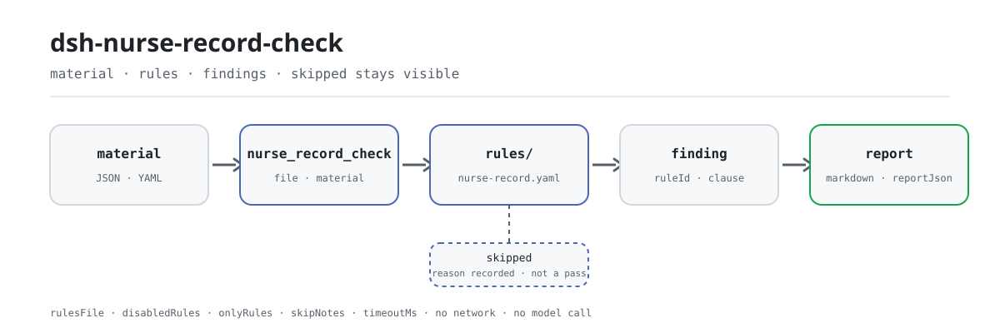

<div align="center">

<picture>
  <source media="(prefers-color-scheme: dark)" srcset="docs/assets/dsh-nurse-record-check-flow-dark.svg">
  
</picture>

# dsh-nurse-record-check

**把一次住院的护理记录核对成一份逐条可复核的差异清单——每条都写明所引条款。**

面向护理部与护士长的本地核对插件：读取护理记录、医嘱与评估表的结构化导出，按版本化规则库检查时限、签名与评估表留存，只列差异，不判合规。

[安装](#三步上手) · [配置](#配置) · [FAQ](#faq) · [简体中文](README.md) · [English](README.en.md) · [Español](README.es.md) · [Português](README.pt.md) · [हिन्दी](README.hi.md)

[](LICENSE)
[](#兼容性)
[](https://www.npmjs.com/package/dsh-nurse-record-check)
[](https://github.com/PerryLink/dsh-nurse-record-check/actions/workflows/ci.yml)
[](#兼容性)

[](https://github.com/PerryLink/dsh-nurse-record-check/stargazers)
[](https://www.npmjs.com/package/dsh-nurse-record-check)
[](https://dshfind.com/en/plugins/PerryLink/dsh-nurse-record-check?ref=badge)
[](https://securityscorecards.dev/viewer/?uri=github.com/PerryLink/dsh-nurse-record-check)
[](https://dsh.market/)

```sh
dsh plugin --profile <name> add dsh-nurse-record-check
```

</div>

<sub>社区插件，与 DeepSeek 官方无关。唯一仓库：<https://github.com/PerryLink/dsh-nurse-record-check>。</sub>

## 它是什么

`dsh-nurse-record-check` 读取一次住院过程的机器可读导出材料——护理记录、医嘱与已完成的评估表——核对这份护理记录的时限、签名与评估表留存，逐条报出与所引条款的字面差异：每条护理记录是否留下可追溯的记录人与时间、日期与时间是否按 24 小时制书写且可解析、抢救记录的时间是否精确到分钟且是否在抢救结束后 6 小时内补记、临时医嘱是否记录执行时间与执行护士签名、取消的医嘱是否记录取消信息、首次护理评估与护理记录书写频次是否满足本机构配置的阈值、跌倒与压力性损伤风险评估表是否留存、巡视间隔是否与该记录所载护理级别对应的分级护理指导原则相符。无法执行的检查计入 `skipped`，不会静默通过。规则库是数据不是代码：替换 `rules/nurse-record.yaml` 就能换一套规则集，加载期会校验每条引文是否逐字、依据等级是否被抬高；检查核心是纯函数，不联网、不调用模型，材料由你交给工具，原件不会被修改。日常核对不需要命令行：把材料交给会话里的 `nurse_record_check` 工具即可。

## 三步上手

1. **安装**（三选一）：

   ```sh
   # git 通道（最新 main；等价于 git+https://github.com/PerryLink/dsh-nurse-record-check.git）
   dsh plugin --profile <name> add github:PerryLink/dsh-nurse-record-check
   # npm 通道（已发布版本）
   dsh plugin --profile <name> add dsh-nurse-record-check
   # tarball 通道：本仓库 pnpm pack 后
   dsh plugin --profile <name> add ./dsh-nurse-record-check-<version>.tgz
   ```

2. **最小配置**（默认规则库与默认阈值即可运行）：

   ```yaml
   - insert:
       - id: dsh-nurse-record-check
         name: dsh-nurse-record-check
   ```

   要收窄检查面时再加 `config`，例如只跑前五条规则：

   ```yaml
   - insert:
       - id: dsh-nurse-record-check
         name: dsh-nurse-record-check
         config:
           onlyRules: [NR-001, NR-002, NR-003, NR-004, NR-005]
   ```

3. **验证已生效**：

   ```sh
   dsh --profile <name> --dump-config | grep 'dsh-nurse-record-check'
   ```

   再用仓内样例离线跑一次核对（样例输出应与 `samples/quickstart/expected/result.json` 一致）：

   ```sh
   pnpm run build
   node samples/quickstart/run.mjs --check
   ```

   ```text
   nurse_record_check: 3 issue(s) — error 1, warn 2, info 0
   skipped: 10
   ```

**卸载**：`dsh plugin --profile <name> remove dsh-nurse-record-check`（或从 profile patch 删掉该行）。

<details>
<summary>在 WorkBuddy / 扣子中安装</summary>

在 WorkBuddy / 扣子搜索「医疗文书质控包」——本检查是其中一项，上架以商城为准。

</details>

## 核心能力

`dsh-nurse-record-check` 把一份住院护理记录的材料变成一份可逐条复核的差异清单，每条差异都带规则 id、严重级、定位与所引条款：

- **一次读取，十二条规则** —— 护理记录、医嘱、评估表一次读入，`NR-001` 至 `NR-012` 依次核对时限、签名与评估表留存。规则表见下。
- **规则库是数据** —— 文档、文号、条款号、逐字摘录与来源地址都写在 `rules/nurse-record.yaml` 里；替换该文件即可切换规则集，不用改代码。
- **无法执行 ≠ 通过** —— 每条跑不成的检查都会出现在 `skipped` 并写明原因；空的问题列表不会被解释成「没有问题」。
- **只列差异，不下结论** —— 报告只指出材料与所引条款之间的字面不符，不判合规、不认定责任、不替代审核人；措辞守卫会拦住定性用语。
- **本地、纯函数核心** —— `src/check.ts` 是 `(input, ruleset, options) => Report` 的纯函数，无 I/O、无时钟、无模型调用，整套规则可在没有凭据的环境里单测。

| 规则 | 核对什么 | 严重级 |
|---|---|---|
| `NR-001` | 每条护理记录都留下可追溯的记录人（工号与时间） | error |
| `NR-002` | 材料中的日期与时间按 24 小时制书写且可解析 | error |
| `NR-003` | 抢救记录的时间精确到分钟 | error |
| `NR-004` | 抢救记录在抢救结束后 6 小时内补记 | error |
| `NR-005` | 临时医嘱记录执行时间与执行护士签名 | error |
| `NR-006` | 执行时间不早于医嘱开立时间 | info |
| `NR-007` | 取消的医嘱记录取消信息与签名 | error |
| `NR-008` | 首次护理评估满足**本机构配置**的时限 | info |
| `NR-009` | 跌倒与压力性损伤风险评估表留存 | warn |
| `NR-010` | 记录时间不早于所记录的事件 | info |
| `NR-011` | 巡视间隔与该记录所载护理级别的分级护理指导原则相符 | error |
| `NR-012` | 护理记录书写频次满足**本机构配置**的策略 | info |

其中 `NR-008` 与 `NR-012` 出厂阈值故意留空，因为规则库没有找到可适用于护理记录的国家层面阈值；它们会把自己列进 `skipped`，绝不静默通过。

## 示例

下面先给详细走查，再用表格回答常见问题。以下示例取自插件自身的测试夹具，不是示意图。

**详细输出** —— 工具 `nurse_record_check`，输入：

```yaml
records:
  - id: REC-0001
    kind: general
    recordedAt: "2026-03-15 09:00"
    nurseId: N10231
  - id: REC-0002
    kind: general
    recordedAt: "2026-03-15 11:00"
    nurseName: 李护士
```

输出：

```json
{
  "id": "dsh-nurse-record-check.NR-001.185cc700",
  "ruleId": "NR-001",
  "severity": "error",
  "locator": {
    "cell": "REC-0002"
  },
  "found": "记录无签名护士标识",
  "expected": "每条护理记录均应有签名"
}
```

*Observed from `dsh-nurse-record-check/tests/fixtures/NR-001/NR-001-unsafe.yaml`*

| 你会问 | 它怎么答 |
|---|---|
| 有一条护理记录导出时没有签名护士，会被报出吗？ | 会。`NR-001` 会报出没有留下记录人标识的护理记录，也会报出不符合所配置工号格式的 `nurseId`。它只核对材料是否留下记录人标识与时间，不校验电子签名的技术实现。 |
| 导出文件里有一个时间值解析不了，这条规则怎么处理？ | `NR-002` 会报出该值，并要求时间按 24 小时制书写、可解析为 `YYYY-MM-DD HH:mm`。解析不了时间的记录随后不参与各条时限比对，所以它只在这里出现，不会变成一条时限差异——本条核对的是时间能否读出，不是时间是否真实。 |
| 抢救记录只写了抢救日期，没有具体时刻。 | `NR-003` 会报出只精确到日的 `rescue` 记录，因为抢救时间应当具体到分钟。规则库说明：它引用的两份文件要求的对象并不相同——一份要求「抢救时间」具体到分钟，另一份要求的是「记录时间」——故合并呈现并分别标注出处。 |
| 抢救记录第二天早上才补记，算超时吗？ | `NR-004` 拿记录时间与 `rescueEndedAt` 相比，间隔超过 6 小时即报出；书写时间早于抢救结束时间也会报出。没有 `rescueEndedAt` 时无从比对，本条会报告无法执行，而不是通过。 |
| 一条临时医嘱执行了，但执行护士签名栏是空的。 | `NR-005` 会报出执行记录缺执行时间或执行护士签名的临时医嘱。它只针对临时医嘱——长期医嘱单的内容项不同，不得互相套用——也不检查执行后多久签名，因为国家规范没有规定签名时限。 |
| 有些规则的结果是 `skipped` 而不是通过，说明什么？ | 说明该检查没有执行，不等于通过。`NR-008` 与 `NR-012` 的阈值（`maxAfterAdmission`、`intervalHours`）出厂为空，因为规则库没有找到可适用于护理记录的国家层面阈值——它同时写明：找到的 24 小时针对的是医师书写的入院记录，不得套用到首次护理评估上——`NR-011` 在特级护理下同样报告 `skipped`，因为指导原则未给出具体间隔，可比的 `rounds` 记录少于两条时也不执行。 |

## 配置

全部可调参数都在 `src/config.ts` 的 Schemastery schema 中，只改 `cordis.yml` 即可生效，无需改代码。

| 键 | 类型 | 默认值 | 说明 |
|---|---|---|---|
| `rulesFile` | string | `rules/nurse-record.yaml` | 规则库文件路径，相对插件包根目录 |
| `disabledRules` | string[] | `[]` | 要停用的规则 id 列表；每条都会出现在 `skipped` 中 |
| `onlyRules` | string[] | `[]` | 只执行这些规则 id；留空表示执行全部规则 |
| `skipNotes` | string | `""` | 附加到每条 `skipped` 说明后的备注 |
| `timeoutMs` | number | `120000` | 工具协作式超时预算（毫秒） |

<details>
<summary>阈值不在 Config 里：它们属于规则库</summary>

`Config` 只有上面 5 个键。按规则变化的阈值写在 `rules/nurse-record.yaml` 的 `params` 中，例如 `NR-008` 的 `maxAfterAdmission`、`NR-012` 的 `intervalHours`、`NR-004` 的 `maxHours`；替换或改写规则库文件时一并调整。

</details>

profile patch 覆盖示例：

```yaml
- insert:
    - id: dsh-nurse-record-check
      name: dsh-nurse-record-check
      config:
        disabledRules: [NR-011]
        skipNotes: 本机构暂未开展分级护理巡视核对
        timeoutMs: 60000
```

## 材料格式

支持 JSON 与 YAML。**docx / xlsx 二进制不会被解析**：病区系统导出的是 JSON 载荷或扁平表，下面这份契约由调用方（或你自己的转换器）填好。Excel 可以先转成 JSON/YAML，对话里也能代转（取决于平台能力）。字段在读取层是可选的，由检查引擎校验，因此部分导出的材料会产生「缺项」类差异，而不是让程序崩溃。

```yaml
target: 内科三病区 2026-03-15 护理记录
episode:
  admittedAt: "2026-03-15 08:00"   # 驱动 NR-008
  careLevel: level-2               # 驱动 NR-011 / NR-012
  patientLabel: 样本患者甲
records:
  - id: REC-0001
    kind: rescue                   # rescue | general | rounds | handover | discharge | other
    recordedAt: "2026-03-15 14:20"
    rescueEndedAt: "2026-03-15 13:50"
    nurseId: N10231
    orderId: ORD-1001              # 把记录关联到医嘱，供 NR-010 使用
orders:
  - id: ORD-1001
    type: temporary                # temporary | long-term
    orderedAt: "2026-03-15 10:00"
    execution: { executedAt: "2026-03-15 10:20", nurseId: N10231, outcome: executed }
    cancellation: { cancelledAt: "2026-03-15 10:10", reason: 患者外出检查 }
assessments:
  - kind: 跌倒坠床风险评估          # 通过共享同义词表匹配
    completedAt: "2026-03-15 09:40"
```

## 依据的标准

| 文件 | 文号 | 引用它的规则 |
|---|---|---|
| 《电子病历应用管理规范（试行）》 | 国卫办医发〔2017〕8号 | NR-001, NR-006, NR-010 |
| 《病历书写基本规范》 | 卫医政发〔2010〕11号 | NR-002, NR-003, NR-004, NR-005, NR-007, NR-010, NR-012 |
| 《医疗质量安全核心制度要点》 | 国卫医发〔2018〕8号 | NR-003, NR-004 |
| 《卫生部办公厅关于在医疗机构推行表格式护理文书的通知》 | 卫办医政发〔2010〕125号 | NR-005 |
| 《护理分级标准》 | WS/T 431—2023（全部代替 WS/T 431—2013；推荐性卫生行业标准，2024-02-01 施行） | NR-008 |
| 《进一步改善护理服务行动计划（2023—2025年）》 | 国卫医政发〔2023〕16号 | NR-009 |
| 《三级医院评审标准（2020年版）》 | 国卫医发〔2020〕26号 | NR-009 |
| 《综合医院分级护理指导原则（试行）》 | 卫医政发〔2009〕49号 | NR-011 |

**边界：** 本插件核对一次**住院**诊疗中**护理**文书（护理记录）的及时性、签名与评估表记录。它不是 `dsh-medrec-qc`（后者核对病案首页及其内部矛盾），不是护理质量评分卡，也不是临床决策辅助工具。它读取机器可读的导出数据，并报出与所引条款之间的字面不符；它从不判定某次诊疗过程是否恰当。

## 规则来源

规则数据与代码分离，每条规则都带文件名、文号、按原文自身编号体系的条款号、逐字摘录与来源地址。加载期强制三件事：摘录必须是真实引文，少于八个字符的摘录会被拒绝；依据仅为原则性条款（`kind: derived-from-principle`，严重级上限 `warn`）或本机构配置（`kind: institutional-configuration`，上限 `info`）的检查不得标为 `error`；夸大依据的规则库会在加载期失败，而不会产出一份看起来很有底气的报告。

条款号已对照以下文件全文核验：《病历书写基本规范》（卫医政发〔2010〕11号）、《综合医院分级护理指导原则（试行）》（卫医政发〔2009〕49号）、《电子病历应用管理规范（试行）》（国卫办医发〔2017〕8号）、《医疗质量安全核心制度要点》（国卫医发〔2018〕8号）、《进一步改善护理服务行动计划（2023—2025年）》（国卫医政发〔2023〕16号）与《护理分级标准》（WS/T 431—2023）。逐条的核验记录在 `rules/evidence/` 目录，入口见 [`rules/evidence/clause-verification.md`](rules/evidence/clause-verification.md)。

核验中有三个发现塑造了这套规则库，记录在此，方便审核者看到哪些结论是被**刻意没有作出**的：

1. **国家层面没有护理记录书写频次的规则。** WS/T 431—2023 删除了 2013 版的「实施要求」章节，分级护理指导原则只规定*巡视*间隔，从不规定*书写*频次。`NR-012` 因此出厂阈值为空。
2. **首次护理评估没有国家层面的时限。** 卫医政发〔2010〕11号第十七条的 24 小时规则约束的是医师书写的入院记录，不是护理评估；套用到这里就是错误引用。`NR-008` 因此出厂阈值为空。
3. **没有条款禁止记录时间早于执行时间。** `NR-010` 的依据是第三条的一般性义务，因此严重级封顶在 `info`。

## FAQ

<details>
<summary>材料会被上传或留存吗？</summary>

不会。本插件是本地检查器：只读取你交给工具的材料，不联网、不调用模型、没有遥测或后台上报；除工具结果与 DSH 宿主自己的会话/日志存储外，它不写任何数据。宿主控制那份存储与其保留策略，本包不会另存一份。卸载本包只移除代码，不会删除宿主已有的会话日志或你创建的文档。

</details>

<details>
<summary>报告里没有问题，是不是就说明这份护理记录合规？</summary>

不是。空的问题列表不能被读成「没有问题」：每条跑不成的检查都会出现在 `skipped` 并写明原因，报告始终带免责声明，措辞守卫拦住合规、责任、正确性一类的定性结论。它只列出材料与所引条款之间的字面差异，由人复核后决定怎么处理。

</details>

<details>
<summary>为什么有些规则总是 skipped？</summary>

因为它们没有可执行的国家阈值，检查器拒绝静默通过。`NR-008`（`maxAfterAdmission`）与 `NR-012`（`intervalHours`）出厂为空，需由本机构配置；`NR-011` 在特级护理下报告 `skipped`（指导原则未给出该级别的具体间隔），可比的 `rounds` 记录少于两条时也不执行。

</details>

<details>
<summary>会和其他 DSH 插件冲突吗？</summary>

本插件只注册一个工具 `nurse_record_check`，通过 `inject: ['tools']` 依赖 tools 服务；它不提供 service key、不注册客户端 slot、不注册 `webServer` 路由、不改写全局对象。工具注册是 Cordis effect，卸载或热重载时自动撤销。它不做网络请求，也不与其他插件交换数据。

</details>

<details>
<summary>性能开销多大？</summary>

检查核心是纯函数：读入 JSON/YAML、跑 12 条规则、生成报告，无网络、无模型调用、无数据库写入，`timeoutMs` 默认 120000 毫秒仅作为协作式超时预算。实际耗时取决于材料大小与规则数量；批量核对整个目录时用 `ptc` 工具模式，schema 成本只付一次。

</details>

## 安全边界与数据

- **只读材料。** 检查器读取你交给工具的文件或内联文本，不修改原件，也不在材料目录里写任何文件。
- **不下定性结论。** 报告从不说某次诊疗合规、违规或恰当；`src/shared/wording.ts` 的措辞守卫会拦住这类表述，报告始终携带免责声明。
- **规则库加载期自检。** 摘录必须是逐字引文且不少于八个字符；`derived-from-principle` 封顶 `warn`、`institutional-configuration` 封顶 `info`；依据被抬高的规则库加载失败，不会产出一份「看起来很有底气」的报告。
- **本地运行。** 无网络请求、无模型调用、无遥测、无凭据读取；除工具结果与宿主会话/日志存储外不写数据（见 `PRIVACY.md`）。
- **注册即 effect。** 工具注册由 `ctx.tools.register` 返回的 disposer 撤销，停止或热重载插件不会留下悬挂的工具。

## 已知限制

- **只解析 JSON / YAML。** docx 与 xlsx 二进制不会被解析；需要先把病区导出转换成上面的材料契约，转换器由调用方提供。
- **墙上时钟。** 全部时间运算都是对输入字符串做本地时间比较，不做时区换算；记录时间就是被写下的那个本地时间。
- **两条规则出厂无阈值。** `NR-008` 与 `NR-012` 在配置阈值前一直 `skipped`；`NR-011` 在特级护理或可比的 `rounds` 记录少于两条时也 `skipped`。
- **引文未取得时只报缺口。** 当某条引文的原文无法取得，对应的发现只能停在 `warn` / `info`，并在 `excerpt` 里说明；这是核验缺口，不是材料合规的证明。
- **不替代人工审核。** 报告只列差异，不判断某次诊疗是否恰当，也不认定责任；最终处置由审核人决定。

## 兼容性

| 项目 | 状态 |
|---|---|
| Harness | 对等版本范围 `>=0.1.2-rc.1 <0.2.0 \|\| >=0.2.0-0 <0.3.0`——已实测同时接受 `0.2.0-rc.2` 与 `0.2.1-rc.2`。`engines.dsh` 声明为 `>=0.2.1-0 <0.3.0`，自 0.2.1 起由宿主强制 |
| Node | `^22.19.0 || >=24.0.0` |
| 平台 | 全平台（纯 ESM；无原生代码、无联网、不调用模型） |
| 工具模式 | `native` / `ptc` 均可；批量校验整个目录时建议 `ptc`，schema 成本只付一次 |

## 生态与质量

- [dshfind 插件页](https://dshfind.com/en/plugins/PerryLink/dsh-nurse-record-check?ref=badge)（安装量与排名）
- [OpenSSF Scorecard 报告](https://securityscorecards.dev/viewer/?uri=github.com/PerryLink/dsh-nurse-record-check)（由 [.github/workflows/scorecard.yml](.github/workflows/scorecard.yml) 驱动）
- [DSH Market](https://dsh.market/)（已上架）
- [npm 包页](https://www.npmjs.com/package/dsh-nurse-record-check)（发布版本与下载量）
- [PerryLink 插件家族](https://github.com/PerryLink) 与 [按材料选核查器](https://perrylink.github.io/zh/checkers/choose/)（62 个核查器 + 通用插件）

## 故障排查

- **插件装上了但工具不出现**：确认 `main` 指向 `lib/index.mjs` 且 `pnpm run build` 已生成该文件；`main` 写错会让加载器静默跳过该条目。
- **`dsh plugin add` 报版本不兼容**：peer 范围覆盖 `0.1.x` 与 `0.2.x`；若运行时在其之外，可显式豁免：`dsh plugin --profile <name> allow-version <包名@版本> --dsh-version <runtime> --accept-risk`。
- **某条规则没有执行**：查看 `skipped` 数组，其中写明了规则 id 与原因；`NR-008`、`NR-012` 在配置阈值前不会运行。
- **`check` 报 `manifest-peers` 失败**：静态检查器比对的是一份早于 0.2 世代的硬编码 peer 范围；安装期的 peer 校验以运行时为准。这是 `dsh-plugin-dev` 的已知上游问题。
- **时间看起来偏移**：全部计算都是对输入字符串做墙上时钟运算，不做时区换算。
- **报告里没有发现问题**：先看 `skippedCount`；空的问题列表不等于合规，见「FAQ」。

## 开发

```sh
pnpm install
pnpm run typecheck                # tsc --noEmit
pnpm test                         # vitest，每条规则有配对的合规/违规夹具
pnpm run build                    # tsdown → lib/index.mjs + lib/index.d.mts
pnpm run verify:self-contained    # 依赖 spec 均来自 registry
pnpm run check:lockfile           # lockfile 漂移检查
pnpm run check:readmes            # 五语 README 一致性
pnpm run check:citations          # 规则库引文核验
pnpm pack                         # 发布 tarball
```

如需刷新共享件：`node ../scripts/sync-shared.mjs dsh-nurse-record-check`，它把 `../_shared` 的共享件同步进 `src/shared/`，每次改动共享件后都要重跑。

| 路径 | 内容 |
|---|---|
| `src/index.ts` | 函数式插件入口：`name`/`inject`/`Config`/`apply`，注册 `nurse_record_check` 工具 |
| `src/check.ts` | 纯检查核心，`(input, ruleset, options) => Report` |
| `src/config.ts` | Schemastery schema，全部可调参数在这里 |
| `src/parse.ts` / `src/view.ts` | JSON/YAML 读取与面向模型的报告投影 |
| `rules/nurse-record.yaml` | 规则库（12 条规则） |
| `rules/evidence/` | 每条引用的条款核验记录 |
| `tests/fixtures/<RULE>/` | 每条规则配对的合规/违规夹具 |
| `samples/quickstart/` | 一分钟离线样例 |

配图由 [`scripts/gen-readme-assets.py`](scripts/gen-readme-assets.py) 程序化生成（Python + Pillow，输出深浅两版 SVG），可重复执行；脚本会探测 CJK 字体，缺字体时报错退出而不是渲染成方块。

Topics：`deepseek-harness`, `dsh`, `dsh-plugin`, `cordis`, `nurse`, `record`

## 家族与致谢

本项目是 [PerryLink](https://github.com/PerryLink) 维护的 DeepSeek Harness 插件家族成员（全部 Apache-2.0）。如果这个插件帮到了你，**给个 star**——它不解锁任何功能，但会让下一个人更容易找到它。

- [@PerryLink](https://github.com/PerryLink) —— 创建者与维护者：规则库、检查核心、材料读取与五语文档。

<details>
<summary>展开全部插件</summary>

| 插件 | 状态 |
|---|---|
| **[dsh-aqua-input-check](https://github.com/PerryLink/dsh-aqua-input-check)** |  |
| **[dsh-archive-check](https://github.com/PerryLink/dsh-archive-check)** |  |
| **[dsh-auto-review](https://github.com/PerryLink/dsh-auto-review)** |  |
| **[dsh-autotier](https://github.com/PerryLink/dsh-autotier)** | 🧊 已冻结 — 见仓库 README |
| **[dsh-bid-ca-precheck](https://github.com/PerryLink/dsh-bid-ca-precheck)** |  |
| **[dsh-bid-qual-check](https://github.com/PerryLink/dsh-bid-qual-check)** |  |
| **[dsh-cert-mcp](https://github.com/PerryLink/dsh-cert-mcp)** | 🧊 已冻结 — 见仓库 README |
| **[dsh-checkpoint-rewind](https://github.com/PerryLink/dsh-checkpoint-rewind)** |  |
| **[dsh-click](https://github.com/PerryLink/dsh-click)** |  |
| **[dsh-composer-history](https://github.com/PerryLink/dsh-composer-history)** |  |
| **[dsh-contract-stance](https://github.com/PerryLink/dsh-contract-stance)** |  |
| **[dsh-customs-doc-check](https://github.com/PerryLink/dsh-customs-doc-check)** |  |
| **[dsh-data-quality](https://github.com/PerryLink/dsh-data-quality)** | 🧊 已冻结 — 见仓库 README |
| **[dsh-demurrage-ledger](https://github.com/PerryLink/dsh-demurrage-ledger)** |  |
| **[dsh-doublecheck](https://github.com/PerryLink/dsh-doublecheck)** |  |
| **[dsh-drill-script-check](https://github.com/PerryLink/dsh-drill-script-check)** |  |
| **[dsh-eia-guide-check](https://github.com/PerryLink/dsh-eia-guide-check)** |  |
| **[dsh-emergency-plan](https://github.com/PerryLink/dsh-emergency-plan)** |  |
| **[dsh-essay-rubric-check](https://github.com/PerryLink/dsh-essay-rubric-check)** |  |
| **[dsh-evidence-check](https://github.com/PerryLink/dsh-evidence-check)** |  |
| **[dsh-export-ctl-check](https://github.com/PerryLink/dsh-export-ctl-check)** |  |
| **[dsh-fast](https://github.com/PerryLink/dsh-fast)** |  |
| **[dsh-fmea-table-check](https://github.com/PerryLink/dsh-fmea-table-check)** |  |
| **[dsh-forecast-penalty](https://github.com/PerryLink/dsh-forecast-penalty)** |  |
| **[dsh-fund-research](https://github.com/PerryLink/dsh-fund-research)** |  |
| **[dsh-github](https://github.com/PerryLink/dsh-github)** |  |
| **[dsh-gongwen-flow-check](https://github.com/PerryLink/dsh-gongwen-flow-check)** |  |
| **[dsh-gongwen-word-check](https://github.com/PerryLink/dsh-gongwen-word-check)** |  |
| **[dsh-guard-plan-qc](https://github.com/PerryLink/dsh-guard-plan-qc)** |  |
| **[dsh-hazchem-check](https://github.com/PerryLink/dsh-hazchem-check)** |  |
| **[dsh-hazplan-check](https://github.com/PerryLink/dsh-hazplan-check)** |  |
| **[dsh-hidden-risk-map](https://github.com/PerryLink/dsh-hidden-risk-map)** |  |
| **[dsh-hs-classify](https://github.com/PerryLink/dsh-hs-classify)** |  |
| **[dsh-icd-rule-check](https://github.com/PerryLink/dsh-icd-rule-check)** |  |
| **[dsh-industry-research](https://github.com/PerryLink/dsh-industry-research)** |  |
| **[dsh-lawcite-adapter](https://github.com/PerryLink/dsh-lawcite-adapter)** |  |
| **[dsh-laya](https://github.com/PerryLink/dsh-laya)** |  |
| **[dsh-lc-doc-check](https://github.com/PerryLink/dsh-lc-doc-check)** |  |
| **[dsh-learning-gap-check](https://github.com/PerryLink/dsh-learning-gap-check)** |  |
| **[dsh-library](https://github.com/PerryLink/dsh-library)** |  |
| **[dsh-local-ai](https://github.com/PerryLink/dsh-local-ai)** |  |
| **[dsh-lsp-actions](https://github.com/PerryLink/dsh-lsp-actions)** |  |
| **[dsh-mask](https://github.com/PerryLink/dsh-mask)** |  |
| **[dsh-mcp-panel](https://github.com/PerryLink/dsh-mcp-panel)** |  |
| **[dsh-medrec-qc](https://github.com/PerryLink/dsh-medrec-qc)** |  |
| **[dsh-memento](https://github.com/PerryLink/dsh-memento)** | 🧊 已冻结 — 见仓库 README |
| **[dsh-nsfc-form-check](https://github.com/PerryLink/dsh-nsfc-form-check)** |  |
| **[dsh-nurse-record-check](https://github.com/PerryLink/dsh-nurse-record-check)** |  |
| **[dsh-observe](https://github.com/PerryLink/dsh-observe)** |  |
| **[dsh-origin-rvc-check](https://github.com/PerryLink/dsh-origin-rvc-check)** |  |
| **[dsh-ota-review-check](https://github.com/PerryLink/dsh-ota-review-check)** |  |
| **[dsh-output-styles](https://github.com/PerryLink/dsh-output-styles)** |  |
| **[dsh-paper-doc-adapter](https://github.com/PerryLink/dsh-paper-doc-adapter)** |  |
| **[dsh-permission-rules](https://github.com/PerryLink/dsh-permission-rules)** |  |
| **[dsh-permit-report-check](https://github.com/PerryLink/dsh-permit-report-check)** |  |
| **[dsh-pipeline-check](https://github.com/PerryLink/dsh-pipeline-check)** |  |
| **[dsh-pleading-draft](https://github.com/PerryLink/dsh-pleading-draft)** |  |
| **[dsh-plugin-doctor](https://github.com/PerryLink/dsh-plugin-doctor)** | 🚫 已退役（仓库已归档） |
| **[dsh-plugin-guide](https://github.com/PerryLink/dsh-plugin-guide)** |  |
| **[dsh-plugin-kit](https://github.com/PerryLink/dsh-plugin-kit)** | 🚫 已退役（仓库已归档） |
| **[dsh-plugin-upgrade](https://github.com/PerryLink/dsh-plugin-upgrade)** | 🚫 已退役（仓库已归档） |
| **[dsh-policy-brief-draft](https://github.com/PerryLink/dsh-policy-brief-draft)** |  |
| **[dsh-power-loss-split](https://github.com/PerryLink/dsh-power-loss-split)** |  |
| **[dsh-power-ticket-check](https://github.com/PerryLink/dsh-power-ticket-check)** |  |
| **[dsh-ppap-check](https://github.com/PerryLink/dsh-ppap-check)** |  |
| **[dsh-protest-deadline](https://github.com/PerryLink/dsh-protest-deadline)** |  |
| **[dsh-railway-window](https://github.com/PerryLink/dsh-railway-window)** |  |
| **[dsh-repair-order-qc](https://github.com/PerryLink/dsh-repair-order-qc)** |  |
| **[dsh-research-report](https://github.com/PerryLink/dsh-research-report)** |  |
| **[dsh-review-reply-check](https://github.com/PerryLink/dsh-review-reply-check)** |  |
| **[dsh-rulefile-check](https://github.com/PerryLink/dsh-rulefile-check)** |  |
| **[dsh-safety-brief-check](https://github.com/PerryLink/dsh-safety-brief-check)** |  |
| **[dsh-score](https://github.com/PerryLink/dsh-score)** | 🧊 已冻结 — 见仓库 README |
| **[dsh-session-sync](https://github.com/PerryLink/dsh-session-sync)** |  |
| **[dsh-site-log-check](https://github.com/PerryLink/dsh-site-log-check)** |  |
| **[dsh-skill-pack-security](https://github.com/PerryLink/dsh-skill-pack-security)** |  |
| **[dsh-soe-decision-check](https://github.com/PerryLink/dsh-soe-decision-check)** |  |
| **[dsh-soilwater-check](https://github.com/PerryLink/dsh-soilwater-check)** |  |
| **[dsh-sop-sync-check](https://github.com/PerryLink/dsh-sop-sync-check)** |  |
| **[dsh-spc-gbt-adapter](https://github.com/PerryLink/dsh-spc-gbt-adapter)** |  |
| **[dsh-talk](https://github.com/PerryLink/dsh-talk)** |  |
| **[dsh-tender-extract](https://github.com/PerryLink/dsh-tender-extract)** |  |
| **[dsh-tender-matrix](https://github.com/PerryLink/dsh-tender-matrix)** |  |
| **[dsh-test-drive](https://github.com/PerryLink/dsh-test-drive)** |  |
| **[dsh-ticktick](https://github.com/PerryLink/dsh-ticktick)** | 🚫 已退役（仓库已归档） |
| **[dsh-translate](https://github.com/PerryLink/dsh-translate)** |  |
| **[dsh-warranty-calc](https://github.com/PerryLink/dsh-warranty-calc)** |  |
| **[dsh-budget](https://github.com/PerryLink/dsh-budget)** | 🧊 已冻结 — 见仓库 README |
| **[dsh-claude-move](https://github.com/PerryLink/dsh-claude-move)** | 🧊 已冻结 — 见仓库 README |
| **[dsh-defend](https://github.com/PerryLink/dsh-defend)** | 🧊 已冻结 — 见仓库 README |
| **[dsh-draw](https://github.com/PerryLink/dsh-draw)** | 🧊 已冻结 — 见仓库 README |
| **[dsh-reach](https://github.com/PerryLink/dsh-reach)** | 🧊 已冻结 — 见仓库 README |
| **[dsh-background-agents](https://github.com/PerryLink/dsh-background-agents)** | 🚫 已退役（仓库已归档） |
| **[dsh-session-pin](https://github.com/PerryLink/dsh-session-pin)** | 🚫 已退役（仓库已归档） |
| **[dsh-team-rooms](https://github.com/PerryLink/dsh-team-rooms)** | 🚫 已退役（仓库已归档） |

</details>

## License

[LICENSE](LICENSE)（Apache License 2.0）© 2026 dsh-nurse-record-check contributors

<p align="center"><sub>Apache-2.0 · 社区插件，与 DeepSeek 无关。</sub></p>
